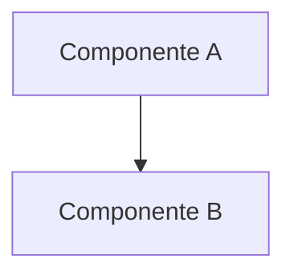
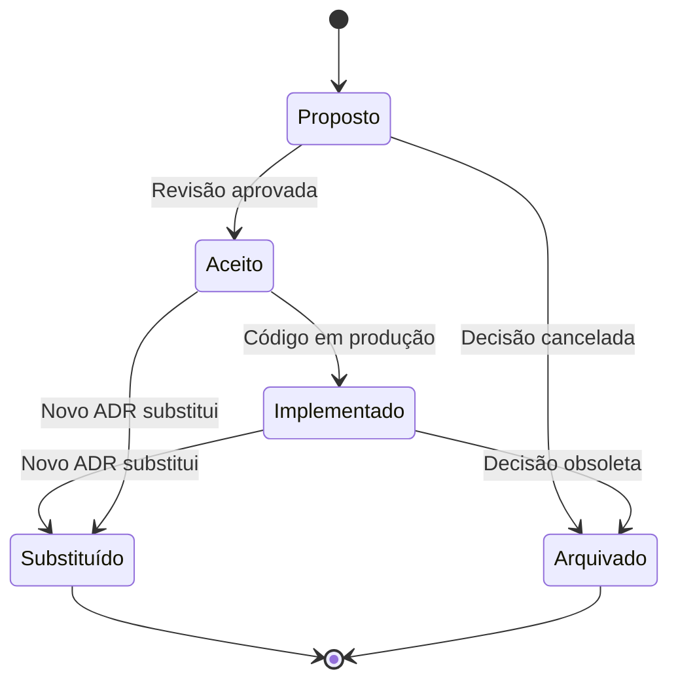

# ADR Generator

## Visão Geral

Esta skill gera Registros de Decisão Arquitetural (ADRs) padronizados para o projeto Veterin. Cada ADR documenta uma decisão técnica relevante, incluindo contexto, alternativas avaliadas, trade-offs e consequências. O objetivo é manter um histórico rastreável e imutável das decisões que moldam a arquitetura do sistema.

## Quando Usar

- Ao criar um novo ADR para uma decisão técnica pendente.
- Ao documentar decisões já tomadas que ainda não possuem registro formal.
- Ao planejar mudanças arquiteturais que impactem múltiplos módulos ou camadas (Domain, Application, Infrastructure, Presentation).
- Ao avaliar trade-offs entre abordagens concorrentes (ex.: escolha de biblioteca, padrão de comunicação, estratégia de cache).
- Ao propor substituição de uma decisão anterior por uma nova abordagem.

## Template do ADR

Todo ADR gerado deve seguir este template:

```markdown
# ADR NNN — Título Descritivo da Decisão

## Status

<!-- Proposto | Aceito | Implementado | Arquivado | Substituído por ADR XXX -->
Proposto

## Data

AAAA-MM-DD

## Contexto

Descreva o problema ou necessidade que motivou esta decisão. Inclua:
- Situação atual do sistema.
- Restrições técnicas e de negócio.
- Requisitos não-funcionais relevantes (performance, segurança, escalabilidade).
- Dependências com outros módulos ou serviços.

## Decisão

Descreva a decisão tomada de forma clara e objetiva. Inclua:
- A abordagem escolhida.
- Tecnologias, padrões ou bibliotecas selecionadas.
- Diagrama Mermaid ilustrando a mudança estrutural (quando aplicável).



## Trade-offs Considerados

| Alternativa | Prós | Contras | Decisão |
|-------------|------|---------|---------|
| Alternativa 1 | ... | ... | Rejeitada |
| Alternativa 2 | ... | ... | **Aceita** |
| Alternativa 3 | ... | ... | Rejeitada |

Justifique brevemente por que cada alternativa foi aceita ou rejeitada.

## Consequências

### Positivas
- Liste os benefícios esperados da decisão.

### Negativas
- Liste os riscos, dívidas técnicas ou limitações introduzidas.

### Neutras
- Liste impactos que não são claramente positivos nem negativos.

## Referências

- Links para documentação relevante, RFCs, issues ou PRs relacionadas.
- ADRs anteriores que influenciaram esta decisão.
```

## Convenção de Nomenclatura

Os arquivos de ADR devem seguir o padrão:

```
NNN_nome_da_demanda.md
```

- **NNN**: número sequencial com 3 dígitos, zero-padded (ex.: `001`, `012`, `100`).
- **nome_da_demanda**: descrição curta em snake_case, sem acentos.

### Exemplos

- `001_autenticacao_jwt.md`
- `002_estrategia_multi_tenant.md`
- `003_migracao_banco_dados.md`
- `010_cache_redis_sessoes.md`

Para determinar o próximo número, verifique o último ADR existente em `docs/engineering/adrs/` e incremente em 1.

## Ciclo de Vida do Status



- **Proposto**: decisão documentada, aguardando revisão e aprovação.
- **Aceito**: decisão aprovada pela equipe, pronta para implementação.
- **Implementado**: código correspondente já está em produção.
- **Arquivado**: decisão não é mais relevante (contexto mudou, funcionalidade removida).
- **Substituído**: decisão foi substituída por um ADR mais recente. Deve referenciar o novo ADR no campo de Status (ex.: `Substituído por ADR 015`).

## Localização

Todos os ADRs devem ser armazenados em:

```
docs/engineering/adrs/
```

Não crie subdiretórios dentro desta pasta. Todos os ADRs residem no mesmo nível.

## Regras de Validação

1. **Imutabilidade**: ADRs com status **Aceito** ou superior são imutáveis. Correções de erros tipográficos são permitidas, mas o conteúdo da decisão não pode ser alterado. Para reverter ou alterar uma decisão, crie um novo ADR que referencie o anterior.
2. **Diagramas Mermaid obrigatórios**: qualquer ADR que envolva mudanças estruturais (novos módulos, alteração de fluxo de dados, mudança de camadas DDD) deve incluir pelo menos um diagrama Mermaid na seção Decisão.
3. **Tabela de trade-offs obrigatória**: a seção Trade-offs Considerados deve conter no mínimo 2 alternativas avaliadas.
4. **Referências cruzadas**: se o ADR substitui ou complementa outro, deve haver referência explícita ao ADR relacionado.
5. **Data válida**: a data deve estar no formato `AAAA-MM-DD` e corresponder à data de criação do ADR.
6. **Numeração sequencial**: o número do ADR deve ser o próximo na sequência, sem lacunas.

## Checklist de Aceitação

Antes de marcar um ADR como **Aceito**, verifique todos os itens abaixo:

- [ ] O título é descritivo e reflete a decisão tomada.
- [ ] O contexto explica claramente o problema ou necessidade.
- [ ] A decisão é objetiva e especifica tecnologias/padrões escolhidos.
- [ ] A tabela de trade-offs contém pelo menos 2 alternativas com prós e contras.
- [ ] As consequências estão categorizadas (positivas, negativas, neutras).
- [ ] Diagramas Mermaid estão incluídos para mudanças estruturais.
- [ ] Referências a ADRs, issues ou documentação relevante estão presentes.
- [ ] A numeração segue a sequência correta.
- [ ] O formato de data está correto (`AAAA-MM-DD`).
- [ ] O nome do arquivo segue a convenção `NNN_nome_da_demanda.md`.
- [ ] O ADR foi revisado por pelo menos um membro da equipe.
- [ ] Impactos em multi-tenancy e isolamento de dados foram considerados.
- [ ] Impactos na hierarquia de roles (superadmin > admin > coordenador > voluntário > veterinário > visualização) foram avaliados.
- [ ] Compatibilidade com o stack atual (Rust/Actix-web, Flutter, Heroku PostgreSQL) foi verificada.
