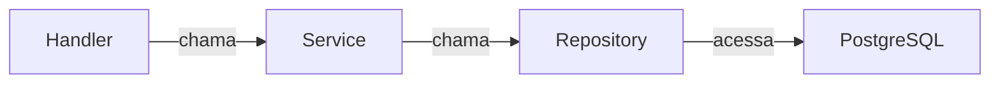

# Padrões de Backend Rust — Veterin

## 1. Visão Geral

O backend do Veterin é construído com a seguinte stack:

| Crate             | Finalidade                                  |
|--------------------|---------------------------------------------|
| `actix-web 4.x`   | Framework HTTP assíncrono                   |
| `sqlx`             | Acesso ao PostgreSQL com queries verificadas em tempo de compilação |
| `serde`            | Serialização/deserialização JSON            |
| `tracing`          | Logging estruturado e observabilidade       |
| `jsonwebtoken`     | Autenticação e autorização via JWT          |
| `thiserror`        | Definição declarativa de tipos de erro      |
| `validator`        | Validação de structs de entrada             |
| `actix-cors`       | Configuração de CORS                        |

> [!IMPORTANT]
> Todo código Rust gerado DEVE seguir os padrões descritos neste documento.
> Não crie código que viole a separação de camadas ou as regras de banco de dados.

---

## 2. Arquitetura — Camadas DDD

A arquitetura segue o padrão Domain-Driven Design com três camadas principais:

```
Handlers (Presentation) → Services (Application) → Repositories (Infrastructure)
```

### Regras de cada camada

| Camada         | Responsabilidade                          | Proibição                              |
|----------------|-------------------------------------------|----------------------------------------|
| **Handlers**   | Receber HTTP, deserializar, responder     | NÃO conter lógica de negócio           |
| **Services**   | Lógica de negócio, orquestração           | NÃO acessar HTTP (Request/Response)    |
| **Repositories** | SQL via sqlx, acesso a dados           | NÃO conter lógica de negócio           |

### Fluxo de dependência



- Handlers recebem `web::Data<AppState>`, extraem claims JWT e delegam ao Service.
- Services recebem referências a Repositories e dados já deserializados.
- Repositories recebem `&PgPool` e executam queries preparadas.

---

## 3. Regras de Banco de Dados

> [!CAUTION]
> NUNCA use o schema `public`. SEMPRE use a variável de ambiente `DATABASE_SCHEMA`.

### Regras obrigatórias

1. **Variável de ambiente**: toda referência a schema deve usar `std::env::var("DATABASE_SCHEMA")`.
2. **Schema `public`**: PROIBIDO em qualquer query, migration ou configuração.
3. **Queries preparadas**: usar SEMPRE `sqlx::query!` ou `sqlx::query_as!` — NUNCA strings interpoladas.
4. **search_path em migrations**: toda migration deve começar com `SET search_path TO <schema>`.
5. **Configuração do PgPool**: incluir `options=-c search_path=<schema>` na connection string.

### Configuração do Pool

```rust
use sqlx::postgres::PgPoolOptions;

pub async fn create_pool() -> Result<PgPool, sqlx::Error> {
    let database_url = std::env::var("DATABASE_URL")
        .expect("DATABASE_URL deve estar definida");
    let schema = std::env::var("DATABASE_SCHEMA")
        .expect("DATABASE_SCHEMA deve estar definida");

    let url_with_schema = format!(
        "{}?options=-c search_path={}",
        database_url, schema
    );

    PgPoolOptions::new()
        .max_connections(5)
        .connect(&url_with_schema)
        .await
}
```

### Exemplo de query preparada

```rust
// ✅ CORRETO — query verificada em tempo de compilação
let animal = sqlx::query_as!(
    Animal,
    r#"SELECT id, nome, especie, tenant_id FROM animais WHERE id = $1 AND tenant_id = $2"#,
    animal_id,
    tenant_id
)
.fetch_optional(&*pool)
.await?;

// ❌ PROIBIDO — string interpolada
let query = format!("SELECT * FROM public.animais WHERE id = {}", id);
```

---

## 4. Padrão de Tratamento de Erros

Usar `thiserror` para definir erros de domínio e implementar `actix_web::ResponseError` para conversão automática em respostas HTTP.

### Definição do AppError

```rust
use actix_web::{HttpResponse, ResponseError};
use thiserror::Error;

#[derive(Debug, Error)]
pub enum AppError {
    #[error("Recurso não encontrado: {0}")]
    NotFound(String),

    #[error("Acesso negado: {0}")]
    Forbidden(String),

    #[error("Erro de validação: {0}")]
    Validation(String),

    #[error("Erro interno: {0}")]
    Internal(String),
}

impl ResponseError for AppError {
    fn error_response(&self) -> HttpResponse {
        match self {
            AppError::NotFound(msg) => {
                HttpResponse::NotFound().json(serde_json::json!({
                    "erro": msg
                }))
            }
            AppError::Forbidden(msg) => {
                HttpResponse::Forbidden().json(serde_json::json!({
                    "erro": msg
                }))
            }
            AppError::Validation(msg) => {
                HttpResponse::BadRequest().json(serde_json::json!({
                    "erro": msg
                }))
            }
            AppError::Internal(msg) => {
                tracing::error!("Erro interno: {}", msg);
                HttpResponse::InternalServerError().json(serde_json::json!({
                    "erro": "Erro interno do servidor"
                }))
            }
        }
    }
}

impl From<sqlx::Error> for AppError {
    fn from(err: sqlx::Error) -> Self {
        AppError::Internal(err.to_string())
    }
}
```

---

## 5. Padrão de Autenticação

### Estrutura de Claims JWT

```rust
use serde::{Deserialize, Serialize};

#[derive(Debug, Serialize, Deserialize, Clone)]
pub struct Claims {
    /// ID do usuário autenticado
    pub user_id: uuid::Uuid,
    /// ID do tenant (isolamento multi-tenant)
    pub tenant_id: uuid::Uuid,
    /// Role do usuário na hierarquia
    pub role: String,
    /// Timestamp de expiração (Unix epoch)
    pub exp: usize,
    /// Role que o usuário está assumindo (impersonação)
    #[serde(skip_serializing_if = "Option::is_none")]
    pub acting_as: Option<String>,
    /// ID do usuário original (quando impersonando)
    #[serde(skip_serializing_if = "Option::is_none")]
    pub original_user: Option<uuid::Uuid>,
}
```

### Hierarquia de roles (da mais alta para a mais baixa)

```
superadmin > admin > coordenador > voluntário > veterinário > visualização
```

### Middleware de extração JWT

```rust
use actix_web::{dev::ServiceRequest, Error, HttpMessage};
use jsonwebtoken::{decode, DecodingKey, Validation, Algorithm};

pub fn extract_claims(req: &ServiceRequest) -> Result<Claims, AppError> {
    let token = req
        .headers()
        .get("Authorization")
        .and_then(|v| v.to_str().ok())
        .and_then(|v| v.strip_prefix("Bearer "))
        .ok_or_else(|| AppError::Forbidden("Token não fornecido".into()))?;

    let secret = std::env::var("JWT_SECRET")
        .expect("JWT_SECRET deve estar definida");

    let token_data = decode::<Claims>(
        token,
        &DecodingKey::from_secret(secret.as_bytes()),
        &Validation::new(Algorithm::HS256),
    )
    .map_err(|e| AppError::Forbidden(format!("Token inválido: {}", e)))?;

    Ok(token_data.claims)
}
```

---

## 6. Padrão de Migrations

### Regras obrigatórias

1. **Primeira linha**: `SET search_path TO <schema>;` — SEMPRE.
2. **Nomenclatura**: `YYYYMMDD_NNN__descricao.sql` (dois underscores antes da descrição).
3. **Idempotência**: usar `IF NOT EXISTS` sempre que possível.

### Exemplo

```sql
-- migrations/20260710_001__criar_tabela_animais.sql

SET search_path TO veterin;

CREATE TABLE IF NOT EXISTS animais (
    id          UUID PRIMARY KEY DEFAULT gen_random_uuid(),
    nome        VARCHAR(255) NOT NULL,
    especie     VARCHAR(100) NOT NULL,
    raca        VARCHAR(100),
    tenant_id   UUID NOT NULL REFERENCES tenants(id),
    created_at  TIMESTAMPTZ NOT NULL DEFAULT NOW(),
    updated_at  TIMESTAMPTZ NOT NULL DEFAULT NOW()
);

CREATE INDEX IF NOT EXISTS idx_animais_tenant_id ON animais(tenant_id);
```

---

## 7. Padrão de Testes

### Regras obrigatórias

1. Módulos de teste devem usar `#[cfg(test)]`.
2. Testes assíncronos devem usar `#[tokio::test]`.
3. Criar helpers para setup do banco de dados de teste.
4. Todo código de produção DEVE ter testes acompanhantes.

### Exemplo de teste de Service

```rust
#[cfg(test)]
mod tests {
    use super::*;

    /// Helper para criar pool de teste
    async fn setup_test_pool() -> PgPool {
        let database_url = std::env::var("DATABASE_URL_TEST")
            .expect("DATABASE_URL_TEST deve estar definida");
        let schema = std::env::var("DATABASE_SCHEMA")
            .unwrap_or_else(|_| "test_veterin".to_string());

        let url = format!("{}?options=-c search_path={}", database_url, schema);

        PgPoolOptions::new()
            .max_connections(2)
            .connect(&url)
            .await
            .expect("Falha ao conectar ao banco de teste")
    }

    #[tokio::test]
    async fn test_criar_animal_sucesso() {
        let pool = setup_test_pool().await;
        let repo = AnimalRepository::new();
        let service = AnimalService::new(repo);

        let input = CriarAnimalInput {
            nome: "Rex".to_string(),
            especie: "Cão".to_string(),
            raca: Some("Labrador".to_string()),
        };

        let tenant_id = uuid::Uuid::new_v4();
        let resultado = service.criar(&pool, tenant_id, input).await;

        assert!(resultado.is_ok());
        let animal = resultado.unwrap();
        assert_eq!(animal.nome, "Rex");
        assert_eq!(animal.tenant_id, tenant_id);
    }

    #[tokio::test]
    async fn test_buscar_animal_nao_encontrado() {
        let pool = setup_test_pool().await;
        let repo = AnimalRepository::new();
        let service = AnimalService::new(repo);

        let id_inexistente = uuid::Uuid::new_v4();
        let tenant_id = uuid::Uuid::new_v4();
        let resultado = service.buscar_por_id(&pool, tenant_id, id_inexistente).await;

        assert!(matches!(resultado, Err(AppError::NotFound(_))));
    }
}
```

---

## 8. Observabilidade

### Configuração de tracing com JSON estruturado

```rust
use tracing_subscriber::{fmt, EnvFilter};

pub fn init_tracing() {
    let filter = EnvFilter::try_from_default_env()
        .unwrap_or_else(|_| EnvFilter::new("info"));

    fmt()
        .json()
        .with_env_filter(filter)
        .with_target(true)
        .with_thread_ids(true)
        .with_file(true)
        .with_line_number(true)
        .init();
}
```

### Uso nos handlers e services

```rust
use tracing::{info, warn, error, instrument};

#[instrument(skip(pool), fields(tenant_id = %tenant_id))]
pub async fn buscar_animal(
    pool: &PgPool,
    tenant_id: uuid::Uuid,
    animal_id: uuid::Uuid,
) -> Result<Animal, AppError> {
    info!("Buscando animal por ID");

    let animal = sqlx::query_as!(
        Animal,
        r#"SELECT id, nome, especie, tenant_id FROM animais WHERE id = $1 AND tenant_id = $2"#,
        animal_id,
        tenant_id
    )
    .fetch_optional(pool)
    .await?
    .ok_or_else(|| {
        warn!("Animal não encontrado");
        AppError::NotFound(format!("Animal {} não encontrado", animal_id))
    })?;

    Ok(animal)
}
```

---

## 9. Cargo.toml — Dependências Obrigatórias

```toml
[dependencies]
actix-web = "4"
actix-cors = "0.7"
sqlx = { version = "0.8", features = ["runtime-tokio", "tls-rustls", "postgres", "uuid", "chrono", "migrate"] }
serde = { version = "1", features = ["derive"] }
serde_json = "1"
jsonwebtoken = "9"
thiserror = "2"
validator = { version = "0.19", features = ["derive"] }
tracing = "0.1"
tracing-subscriber = { version = "0.3", features = ["json", "env-filter"] }
uuid = { version = "1", features = ["v4", "serde"] }
chrono = { version = "0.4", features = ["serde"] }
tokio = { version = "1", features = ["full"] }
dotenvy = "0.15"

[dev-dependencies]
tokio = { version = "1", features = ["full", "test-util"] }
actix-rt = "2"
```

---

## 10. Exemplos de Código — Padrões Completos

### Handler (Camada de Apresentação)

```rust
use actix_web::{web, HttpResponse, HttpRequest};
use validator::Validate;

/// Handler — apenas extrai dados HTTP e delega ao Service
pub async fn criar_animal(
    req: HttpRequest,
    state: web::Data<AppState>,
    body: web::Json<CriarAnimalInput>,
) -> Result<HttpResponse, AppError> {
    let claims = extract_claims_from_request(&req)?;

    body.validate()
        .map_err(|e| AppError::Validation(e.to_string()))?;

    let animal = state
        .animal_service
        .criar(&state.pool, claims.tenant_id, body.into_inner())
        .await?;

    Ok(HttpResponse::Created().json(animal))
}

pub async fn listar_animais(
    req: HttpRequest,
    state: web::Data<AppState>,
) -> Result<HttpResponse, AppError> {
    let claims = extract_claims_from_request(&req)?;

    let animais = state
        .animal_service
        .listar(&state.pool, claims.tenant_id)
        .await?;

    Ok(HttpResponse::Ok().json(animais))
}
```

### Service (Camada de Aplicação)

```rust
use tracing::{info, instrument};

pub struct AnimalService {
    repo: AnimalRepository,
}

impl AnimalService {
    pub fn new(repo: AnimalRepository) -> Self {
        Self { repo }
    }

    /// Cria um novo animal com validações de negócio
    #[instrument(skip(self, pool))]
    pub async fn criar(
        &self,
        pool: &PgPool,
        tenant_id: uuid::Uuid,
        input: CriarAnimalInput,
    ) -> Result<Animal, AppError> {
        // Regra de negócio: nome não pode estar vazio
        if input.nome.trim().is_empty() {
            return Err(AppError::Validation("Nome é obrigatório".into()));
        }

        info!(tenant_id = %tenant_id, nome = %input.nome, "Criando novo animal");

        self.repo.inserir(pool, tenant_id, input).await
    }

    #[instrument(skip(self, pool))]
    pub async fn buscar_por_id(
        &self,
        pool: &PgPool,
        tenant_id: uuid::Uuid,
        id: uuid::Uuid,
    ) -> Result<Animal, AppError> {
        self.repo
            .buscar_por_id(pool, tenant_id, id)
            .await?
            .ok_or_else(|| AppError::NotFound(format!("Animal {} não encontrado", id)))
    }

    #[instrument(skip(self, pool))]
    pub async fn listar(
        &self,
        pool: &PgPool,
        tenant_id: uuid::Uuid,
    ) -> Result<Vec<Animal>, AppError> {
        self.repo.listar(pool, tenant_id).await
    }
}
```

### Repository (Camada de Infraestrutura)

```rust
pub struct AnimalRepository;

impl AnimalRepository {
    pub fn new() -> Self {
        Self
    }

    /// Insere um animal no banco — apenas SQL, sem lógica de negócio
    pub async fn inserir(
        &self,
        pool: &PgPool,
        tenant_id: uuid::Uuid,
        input: CriarAnimalInput,
    ) -> Result<Animal, AppError> {
        let animal = sqlx::query_as!(
            Animal,
            r#"
            INSERT INTO animais (nome, especie, raca, tenant_id)
            VALUES ($1, $2, $3, $4)
            RETURNING id, nome, especie, raca, tenant_id, created_at, updated_at
            "#,
            input.nome,
            input.especie,
            input.raca,
            tenant_id
        )
        .fetch_one(pool)
        .await?;

        Ok(animal)
    }

    pub async fn buscar_por_id(
        &self,
        pool: &PgPool,
        tenant_id: uuid::Uuid,
        id: uuid::Uuid,
    ) -> Result<Option<Animal>, AppError> {
        let animal = sqlx::query_as!(
            Animal,
            r#"
            SELECT id, nome, especie, raca, tenant_id, created_at, updated_at
            FROM animais
            WHERE id = $1 AND tenant_id = $2
            "#,
            id,
            tenant_id
        )
        .fetch_optional(pool)
        .await?;

        Ok(animal)
    }

    pub async fn listar(
        &self,
        pool: &PgPool,
        tenant_id: uuid::Uuid,
    ) -> Result<Vec<Animal>, AppError> {
        let animais = sqlx::query_as!(
            Animal,
            r#"
            SELECT id, nome, especie, raca, tenant_id, created_at, updated_at
            FROM animais
            WHERE tenant_id = $1
            ORDER BY created_at DESC
            "#,
            tenant_id
        )
        .fetch_all(pool)
        .await?;

        Ok(animais)
    }
}
```
