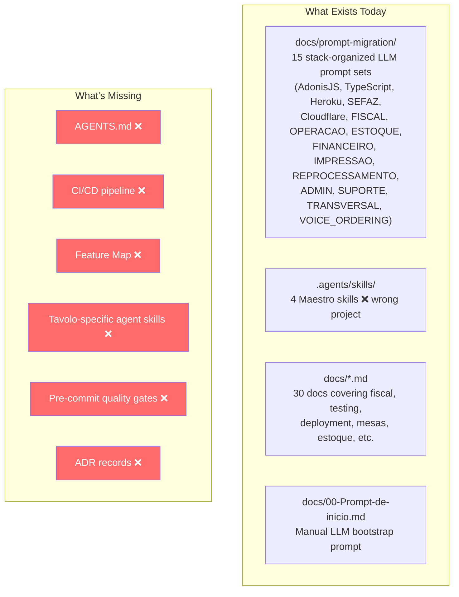

# Plan: AI-Driven Development Instrumentation & Tavolo Feature Map

> **Version:** 1.0 · **Date:** 2026-07-09 · **Model:** Claude Opus 4.6 (Thinking)
> **Rationale:** This is a planning-heavy task requiring deep codebase analysis, architectural reasoning, and document synthesis — well suited for a high-reasoning model.

## Goal

Two deliverables:

1. **Instrument Tavolo for AI-driven development** — Create the foundational files (`AGENTS.md`, `.agents/` restructure, quality gates, CI hooks) that enable any AI coding agent (Antigravity, Claude Code, Aider, Cursor) to work effectively on this codebase with high standards.

2. **Create a Tavolo Feature Map** — A living strategic document modeled on the [template_FEATURE_MAP.md](file:///home/bro/projects/tavolo/docs/template_FEATURE_MAP.md) template, but adapted for Tavolo's actual domains, features, and competitive landscape (restaurant POS/ERP market).

---

## User Review Required

> [!IMPORTANT]
> **The `.agents/skills/` directory currently contains skills from a different project (Maestro/Harness — a Rust+Nim agentic orchestrator).** These 4 skills (`fsm-orchestration`, `github-delivery`, `rag-operations`, `spec-driven-dev`) reference Maestro concepts (micro-project FSM, Two-Towers routing, etc.) that don't apply to Tavolo. The plan proposes archiving them and creating Tavolo-specific skills.

> [!IMPORTANT]
> **The `template_FEATURE_MAP.md` is also from Maestro**, benchmarked against AI coding tools (OpenCode, Claude Code, Aider, MetaGPT). The Tavolo Feature Map will use the **card format and structure** from the template but will benchmark against **restaurant SaaS competitors** (iFood Gestão, Goomer, Saipos, MarketMan, Toast, Square for Restaurants).

> [!WARNING]
> **No CI/CD exists** — there is no `.github/workflows/` directory. The plan creates a foundational GitHub Actions pipeline.

---

## Open Questions

> [!IMPORTANT]
> **Q1:** Should the archived Maestro skills be **deleted** or moved to `.agents/archive/maestro/`? The plan defaults to archiving for reference.

> [!IMPORTANT]
> **Q2:** Do you want the CI pipeline to auto-deploy to Heroku (current deploy target), or just run quality gates (lint, typecheck, test, build)?

> [!IMPORTANT]
> **Q3:** The Feature Map will benchmark against restaurant SaaS competitors. Are there specific competitors you want prioritized beyond the ones I've identified (iFood Gestão, Goomer, Saipos, MarketMan, Toast, Square)?

---

## Research Summary

### Current State



### Codebase Statistics

| Layer | Count | Key Items |
|-------|-------|-----------|
| Controllers | 37 | fiscal, pedidos, comandas, cardapio, vendas, admin, voice, reports... |
| Models | 32 | pedido, venda, comanda, mesa, fiscal_note, insumo, user, empresa... |
| Services | 35 | fiscal pipeline (12 services), voice ordering (4), processing engine, stock... |
| Middleware | 8 | auth, guest, superadmin, theme, https redirect... |
| Helpers | 8 | fiscal_formatters, number_formatter, timezone, qrcode, edge_helpers... |
| Migrations | 82 | Full schema evolution history |
| Tests (functional) | 8 | auth, caixa, cardapios, comandas, dashboard, fiscal, pedido flow |
| Tests (unit) | 15+ | mesas, comandas, pedido, insumo stock, fiscal routing, processing engine |
| Views | ~40+ | Edge.js templates for all screens |
| Config files | 12 | app, auth, database, logger, mail, session, shield, static, vite, voice... |
| Prompt sets | 15 stacks × 11 files | ~165 LLM context documents |

---

## Proposed Changes

### Component 1: Root-Level AI Instrumentation

#### [NEW] `AGENTS.md`

The central file all AI tools read. Establishes project identity, conventions, quality gates, and guardrails.

```markdown
# AGENTS.md — Tavolo Restaurant Management System

## Identity
- **Project:** Tavolo — Full-stack restaurant ERP (AdonisJS v6 + PostgreSQL + Edge.js)
- **Language:** TypeScript (strict), SQL
- **Framework:** AdonisJS v6 (Lucid ORM, Vine.js validation, Edge.js templates)
- **Deploy:** Heroku (web dyno + release phase for migrations)
- **Test runner:** Japa (unit + functional suites)

## Architecture Rules
1. Controllers are thin — business logic lives in `app/services/`.
2. All database access goes through Lucid ORM models in `app/models/`.
3. Validation uses Vine.js validators (not inline validation).
4. Views are Edge.js templates in `resources/views/`.
5. Routes are defined in `start/routes.ts` — always verify controller#method exists.
6. Multi-tenant: most entities scope to `empresa_id`.
7. Fiscal module is critical-path — never modify without build verification.

## Quality Gates (run before every PR)
```bash
npm run typecheck          # Zero TS errors
npm run lint               # Zero lint errors  
npm test                   # All unit tests pass
npm run build              # Production build succeeds
```

## Naming Conventions
- Models: PascalCase singular Portuguese (`CardapioProduto`, `FiscalNote`)
- Controllers: snake_case plural Portuguese + `_controller` suffix
- Migrations: timestamp prefix, snake_case
- Services: snake_case + `_service` suffix (e.g., `fiscal_emission_workflow.ts`)
- Tables: snake_case plural Portuguese (`cardapio_produtos`, `fiscal_notes`)

## Critical Paths — Extra Caution Required
- `app/services/fiscal_*` — SEFAZ integration, XML signing, NFC-e emission
- `app/services/voice_*` — OpenAI API integration (BYOK encrypted keys)
- `database/migrations/` — Never modify existing migrations, only add new ones
- `start/routes.ts` — Route→controller audit required after changes

## Documentation Protocol
- Update `docs/CHANGELOG.md` for every feature/fix
- Run `npx -y markdownlint-cli2 "docs/**/*.md" "*.md"` before committing docs
- If adding a new module, create prompt set: `npm run prompts:bootstrap-stack -- <NAME>`

## Environment
- Dev: `npm run dev` (HMR via Vite)
- Test: `npm test` (Japa runner, `NODE_ENV=test`)
- Build: `npm run build` → `node build/bin/server.js`
- Fiscal key: `FISCAL_ENCRYPTION_KEY` (AES-256, 32 bytes hex)
```

---

#### [NEW] `.github/workflows/ci.yml`

Foundational CI pipeline that enforces the quality gates.

```yaml
name: CI
on:
  push:
    branches: [main]
  pull_request:
    branches: [main]

jobs:
  quality:
    runs-on: ubuntu-latest
    steps:
      - uses: actions/checkout@v4
      - uses: actions/setup-node@v4
        with:
          node-version: '20'
          cache: 'npm'
      - run: npm ci
      - run: npm run typecheck
      - run: npm run lint
      - run: npm test
      - run: npm run build
```

---

#### [NEW] `.editorconfig` update verification

Already exists (337 bytes). Will verify it matches project conventions.

---

### Component 2: Agent Skills Restructure

#### [ARCHIVE] `.agents/skills/fsm-orchestration/`
#### [ARCHIVE] `.agents/skills/github-delivery/`
#### [ARCHIVE] `.agents/skills/rag-operations/`
#### [ARCHIVE] `.agents/skills/spec-driven-dev/`

Move to `.agents/archive/maestro/` for reference.

#### [NEW] `.agents/skills/tavolo-fiscal/SKILL.md`

```markdown
---
name: tavolo-fiscal
description: "Use when working on NFC-e/NF-e emission, SEFAZ integration, fiscal config, XML signing, or any fiscal module code."
---

# Tavolo Fiscal Skill

## Use When
- Modifying fiscal services (fiscal_emission_workflow, fiscal_routing_service, etc.)
- Working with SEFAZ XML/SOAP communication
- Changing fiscal_notes or fiscal_configs models/migrations
- Debugging NFC-e/NF-e emission failures

## Critical Files
- `app/services/fiscal_emission_workflow.ts` — Main orchestrator
- `app/services/fiscal_routing_service.ts` — UF-specific SEFAZ routing
- `app/services/fiscal_signer.ts` — XML digital signing (A1 cert)
- `app/services/fiscal_xml_validator.ts` — Schema validation
- `app/services/fiscal_transmitter.ts` — SEFAZ SOAP transmission
- `app/models/fiscal_note.ts` — Note lifecycle
- `app/models/fiscal_config.ts` — Per-empresa fiscal setup

## Workflow
1. Always run `npm run build` before and after changes — fiscal code is critical path.
2. Review `docs/FISCAL_ENGINE_GUIDE.md` and `docs/FISCAL_ENGINE_EXAMPLES.md` for context.
3. Test with `npm test -- tests/unit/fiscal_routing_service.spec.ts`.
4. Never modify encryption key handling without reviewing `FISCAL_ENCRYPTION_KEY_CONFIG.md`.

## Outputs
- Build passes, fiscal tests pass, no regression in XML signing or SEFAZ routing.
```

#### [NEW] `.agents/skills/tavolo-operations/SKILL.md`

For mesas, comandas, pedidos, and kitchen workflow.

#### [NEW] `.agents/skills/tavolo-inventory/SKILL.md`

For insumos, reservas, stock logic, and NFe import.

#### [NEW] `.agents/skills/tavolo-financial/SKILL.md`

For vendas, caixa, reports, and discount logic.

#### [NEW] `.agents/skills/tavolo-voice/SKILL.md`

For voice ordering pipeline (Whisper STT → GPT NLU → action execution).

---

### Component 3: Feature Map

#### [NEW] `docs/FEATURE_MAP.md`

A comprehensive Tavolo-specific feature map following the template structure. Key differences from the Maestro template:

| Template Aspect | Maestro (template) | Tavolo (new) |
|---|---|---|
| Product | Agentic workflow orchestrator (Rust+Nim) | Restaurant ERP (AdonisJS+PostgreSQL) |
| Competitors | OpenCode, Claude Code, Aider, MetaGPT | iFood Gestão, Goomer, Saipos, Toast, Square |
| Domains | CLI, Multi-Agent Runtime, FSM, Providers, Governance, TUI, Delivery | Almoxarifado, Cardápio, Operação, Financeiro, Fiscal, Voice, Suporte, Admin, Landing |
| Technology | Rust core + Nim TUI | TypeScript + AdonisJS + PostgreSQL + Edge.js |

**Feature Map Structure:**

```
# Tavolo Feature Map

## Overview (status dashboard, value distribution)

## Domain 1: Almoxarifado (Inventory & Supply Chain)
  1.1 Fornecedores CRUD
  1.2 Insumos Management
  1.3 NFe Import via XML
  1.4 Stock Reservation System
  1.5 Min/Max Alerts

## Domain 2: Cardápio (Menu & Recipes)
  2.1 Categorias CRUD
  2.2 Produtos with Recipes
  2.3 Cost Calculation
  2.4 Cardápio Virtual (customer-facing)
  2.5 Image Management (Cloudflare)

## Domain 3: Operação (Tables, Orders & Kitchen)
  3.1 Mesas Management
  3.2 Comandas System
  3.3 Pedidos Lifecycle (7 states)
  3.4 Kitchen Kanban Dashboard
  3.5 Discount System
  3.6 Service Tax

## Domain 4: Financeiro (Financial)
  4.1 Vendas Registration
  4.2 Caixa (Cash Register) Open/Close
  4.3 Payment Methods (Cash/Card/PIX)
  4.4 Reports & Analytics
  4.5 Profitability Analysis

## Domain 5: Fiscal (Tax & NFC-e/NF-e)
  5.1 NFC-e Emission Pipeline
  5.2 NF-e Support
  5.3 Multi-UF SEFAZ Routing
  5.4 XML Signing (A1 Certificate)
  5.5 Contingency Mode (offline)
  5.6 Retry & Reprocessing
  5.7 QR Code Generation
  5.8 XSD Validation

## Domain 6: Voice Ordering (AI-Powered)
  6.1 Whisper STT Transcription
  6.2 GPT-4o-mini Intent Parsing
  6.3 8 Action Intents
  6.4 Preview/Confirm Flow
  6.5 BYOK API Key Management

## Domain 7: Suporte & Admin
  7.1 Ticket System
  7.2 Subscription Management
  7.3 Multi-tenant Admin
  7.4 User Roles & Permissions
  7.5 Theme System (dark/light)
  7.6 Print Configuration
  7.7 Processing Engine

## Domain 8: Platform & Infrastructure
  8.1 Authentication System
  8.2 Multi-tenant Architecture
  8.3 Heroku Deployment
  8.4 Cloudflare R2 (images, logs)
  8.5 Landing Page & SEO
  8.6 WCAG Accessibility
  8.7 Timezone Handling

## Competitive Positioning
## Prioritized Feature Roadmap
## Source File Index
```

Each feature gets the standard card:
- **Status:** ✅ / 🚧 / ⬜ / 📋
- **Source:** file path(s)
- **Business Value:** 🔴 / 🟠 / 🟡 / 🟢
- **What It Does Today / What It Should Do / Gap**
- **Competitor Benchmark**

---

### Component 4: Quality & Process Files

#### [NEW] `docs/ADR/000-adr-template.md`

Architecture Decision Record template for tracking significant design decisions.

#### [MODIFY] `docs/INDEX.md`

Add references to the new AGENTS.md, FEATURE_MAP.md, and ADR directory.

---

## File Delivery Summary

| # | Action | Path | Purpose |
|---|--------|------|---------|
| 1 | **NEW** | `AGENTS.md` | AI agent instructions |
| 2 | **NEW** | `.github/workflows/ci.yml` | CI quality gates |
| 3 | **ARCHIVE** | `.agents/skills/{4 Maestro skills}` → `.agents/archive/maestro/` | Clear mismatched skills |
| 4 | **NEW** | `.agents/skills/tavolo-fiscal/SKILL.md` | Fiscal module skill |
| 5 | **NEW** | `.agents/skills/tavolo-operations/SKILL.md` | Operations skill |
| 6 | **NEW** | `.agents/skills/tavolo-inventory/SKILL.md` | Inventory skill |
| 7 | **NEW** | `.agents/skills/tavolo-financial/SKILL.md` | Financial skill |
| 8 | **NEW** | `.agents/skills/tavolo-voice/SKILL.md` | Voice ordering skill |
| 9 | **NEW** | `docs/FEATURE_MAP.md` | Strategic feature inventory (~1200 lines) |
| 10 | **NEW** | `docs/ADR/000-adr-template.md` | ADR template |
| 11 | **MODIFY** | `docs/INDEX.md` | Add new doc references |

---

## Verification Plan

### Automated Tests

```bash
# Ensure no existing functionality is broken
npm run typecheck
npm run lint
npm test
npm run build

# Validate markdown
npx -y markdownlint-cli2 "docs/**/*.md" "*.md" "AGENTS.md"

# Validate CI YAML syntax
python3 -c "import yaml; yaml.safe_load(open('.github/workflows/ci.yml'))" 2>/dev/null || echo "Install PyYAML or use yamllint"
```

### Manual Verification

1. **AGENTS.md** — Open in IDE; confirm all file paths referenced actually exist
2. **Feature Map** — Verify every `Source:` file path exists; confirm status matches codebase reality
3. **Agent skills** — Verify each SKILL.md references real files
4. **CI pipeline** — Confirm `.github/workflows/ci.yml` syntax is valid
5. **Route audit** — Run the route→controller integrity check from `docs/TESTING.md`

---

*This plan creates no code changes to the application itself — only documentation, instrumentation, and CI infrastructure. Zero risk to production.*

## Validation Evidence
- Verified AGENTS.md creation.
- Verified .github/workflows/ci.yml creation.
- Verified .agents/skills restructure.
- Verified FEATURE_MAP.md creation.
- Verified ADR template creation.
- Completed.
