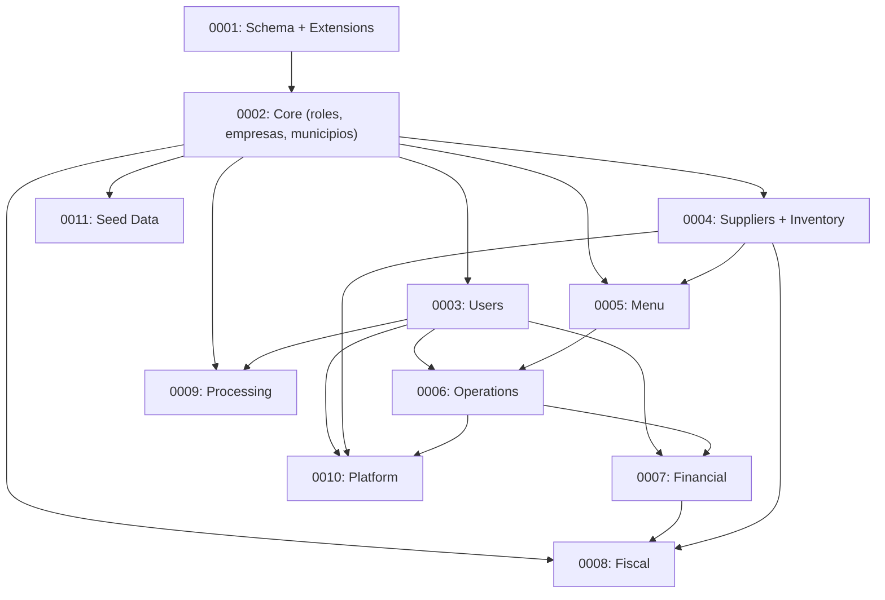

# Migration Consolidation Plan

## Goal
Replace the current 83 messy, broken migration files with **10 clean, idempotent migrations** that create the entire Tavolo database schema from scratch inside a dedicated PostgreSQL schema named `tavolo`. Archive old migrations to `docs/archived_migrations/` for reference.

## Background

The current migration set has accumulated severe technical debt:
- **83 files** including 14 NO-OPs, redundant renames, and conflicting ALTER sequences
- Missing `await` keywords caused asynchronous execution bugs
- Columns were added, dropped, and re-added across multiple migrations (e.g., `fiscal_notes.comanda_id`)
- Table renames (`tables → mesas → comandas`) left ghost references
- Migrations fail on fresh databases due to ordering issues

The **ORM models** (32 files, 33 tables) are the source of truth for the desired final schema.

## User Review Required

> [!CAUTION]
> **Production Data Impact**: This plan assumes the Heroku database can be **wiped and re-created from scratch**. If there is existing production data that must be preserved, we need a different migration strategy (e.g., move tables to the new schema instead of recreating).

> [!IMPORTANT]
> **Heroku Reset Required**: After deploying, you must reset the `adonis_schema` tracking table on Heroku so Adonis doesn't think the old 83 migrations have already run. The simplest approach is:
> ```sql
> DROP TABLE IF EXISTS public.adonis_schema;
> DROP TABLE IF EXISTS public.adonis_schema_versions;
> ```

## Open Questions

> [!IMPORTANT]
> **1. Can we wipe the Heroku database?** The new migrations create everything from scratch. If you have data in production, we'd need a data migration strategy instead.

> [!IMPORTANT]
> **2. Seed data**: The old migrations seeded roles (`admin`, `gerente`, `funcionario`, `superadmin`) and funcoes (`Atendente`, `Cozinheiro`, etc.). Should these be in a migration or a separate seeder file?

---

## Proposed Changes

### Component 1: Archive Old Migrations

#### [NEW] `docs/archived_migrations/`
Move all 83 existing migration files from `database/migrations/` to `docs/archived_migrations/` for reference. No code changes — just a `git mv`.

---

### Component 2: Database Configuration

#### [MODIFY] `config/database.ts`
Ensure `searchPath` is set to `['tavolo', 'public']` and migration tracking uses the `tavolo` schema:

```diff
 postgres: {
   client: 'pg',
   connection: env.get('DATABASE_URL')
     ? { connectionString: env.get('DATABASE_URL'), ssl: ... }
     : { host: ..., port: ..., user: ..., password: ..., database: ... },
-  searchPath: ['tavolo'],
+  searchPath: ['tavolo', 'public'],
   debug: env.get('NODE_ENV') !== 'production',
   migrations: {
     naturalSort: true,
     paths: ['database/migrations'],
+    schemaName: 'tavolo',
   },
 },
```

> [!NOTE]
> `searchPath: ['tavolo', 'public']` tells Knex to issue `SET search_path TO 'tavolo','public'` on every connection. The `public` fallback is needed for PostgreSQL extensions like `unaccent`. The `schemaName: 'tavolo'` tells Adonis to create the `adonis_schema` tracking table inside the `tavolo` schema.

---

### Component 3: New Clean Migrations (10 files)

All migrations use the final column definitions derived from the **32 ORM models** — not from the messy migration net-effect. Each file is fully `await`ed and idempotent where possible.

#### [NEW] `1900000000001_create_schema_and_extensions.ts`
Creates the `tavolo` schema and enables required PostgreSQL extensions.

```typescript
export default class extends BaseSchema {
  async up() {
    await this.db.rawQuery('CREATE SCHEMA IF NOT EXISTS tavolo')
    await this.db.rawQuery('CREATE EXTENSION IF NOT EXISTS unaccent')
  }
  async down() {
    await this.db.rawQuery('DROP SCHEMA IF EXISTS tavolo CASCADE')
  }
}
```

---

#### [NEW] `1900000000002_create_core_tables.ts`
Creates the foundational tables with no cross-dependencies: `roles`, `empresas`, `municipios_ibge`.

| Table | Columns (summary) |
|-------|-------------------|
| **roles** | id, name (unique), description, permissions (json), active, timestamps |
| **empresas** | id, razao_social, trade_name, cnpj (nullable), cpf, document_type, ie, im, regime_tributario, cod_municipio, address fields, phone, email, website, active, logo_url, nota_fiscal_footer_message, state, timestamps |
| **municipios_ibge** | codigo (PK string), nome, uf, codigo_uf |

Key design decisions:
- `empresas.name` is **removed** — `razao_social` is the primary name field (NOT NULL)
- `empresas.cnpj` is **nullable** (CPF-only businesses)
- `empresas.logo_data/logo_mime_type/logo_filename` are **excluded** (model doesn't use them; Cloudflare Images via `logo_url`)

---

#### [NEW] `1900000000003_create_users_table.ts`
Creates the `users` table (depends on `roles`, `empresas`).

| Column | Type | Notes |
|--------|------|-------|
| id | serial PK | |
| full_name | string | nullable |
| email | string(254) | unique, NOT NULL |
| password | string | NOT NULL |
| cpf | string(14) | nullable |
| phone | string | nullable |
| birth_date | date | nullable |
| status | enum | active/inactive/suspended |
| theme | string(50) | default 'Light' |
| email_verified | boolean | default false |
| verification_token | string | nullable |
| verification_token_expires_at | timestamp | nullable |
| email_verified_at | timestamp | nullable |
| empresa_id | integer | FK→empresas, CASCADE |
| role_id | integer | FK→roles, RESTRICT |
| created_by | integer | FK→users (self-ref) |
| updated_by | integer | FK→users (self-ref) |
| timestamps | | |

---

#### [NEW] `1900000000004_create_supplier_and_inventory_tables.ts`
Creates `fornecedores`, `insumos`.

**fornecedores** — 24 columns including full address, document, payment_terms enum, FK→empresas.

**insumos** — 28 columns including stock tracking, fiscal fields (ncm, cest), decimal(12,2) precision, FK→empresas, FK→fornecedores.

---

#### [NEW] `1900000000005_create_menu_tables.ts`
Creates `cardapio_categorias`, `cardapio_produtos`, `cardapio_produtos_ingredientes`, `cardapios_virtuais`.

**cardapio_produtos** — Full schema with all fiscal fields from the model:
- ncm, cfop, cst_icms, csosn, icms_rate, pis_rate, cofins_rate, cest, unit, barcode, origem
- requires_preparation, dietary flags, spice_level enum
- NO binary image columns (image_data, image_mime_type, image_filename excluded)

**cardapio_produtos_ingredientes** — With CASCADE delete on cardapio_produto_id FK.

---

#### [NEW] `1900000000006_create_operations_tables.ts`
Creates `mesas`, `comandas`, `funcionarios`, `funcoes`, `funcionario_funcoes`, `pedidos`, `pedido_itens`.

**mesas** — Created with `status` (enum) and `capacity` columns from the start. No more deferred ALTER.

**comandas** — Clean schema: empresa_id, mesa_id (FK→mesas), number, name, notes, active. No legacy `location`, `capacity`, `status`, `sort_order`, `is_active`.

**pedidos** — FK to `comandas` (not `tables`), `funcionarios`, `users`. All timestamp fields.

**pedido_itens** — Includes `started_at` from the start.

---

#### [NEW] `1900000000007_create_financial_tables.ts`
Creates `vendas`, `venda_itens`, `caixa_registros`.

**vendas** — FK→empresas, pedidos, comandas, users. All financial columns.

**venda_itens** — FK→vendas, cardapio_produtos, pedido_itens.

**caixa_registros** — Full cash register schema with UNIQUE(empresa_id, register_date).

---

#### [NEW] `1900000000008_create_fiscal_tables.ts`
Creates `fiscal_configs`, `fiscal_notes`, `notas_fiscais`, `nota_fiscal_itens`.

**fiscal_configs** — UUID PK, establishment_id (integer FK→empresas), multi-UF fields (state_override, autorizador, serie).

**fiscal_notes** — UUID PK, **only `venda_id`** FK (no comanda_id or order_id — the model only has vendaId). Includes retry fields (attempt_count, last_attempt_at, etc.) and multi-UF fields (uf, numero, serie).

> [!NOTE]
> The `comanda_id` column saga is resolved: the FiscalNote model only declares `vendaId`, so the clean migration only creates `venda_id`. The old `comanda_id` and `order_id` are gone.

**notas_fiscais** — Inbound NFe from suppliers. FK→empresas, fornecedores.

**nota_fiscal_itens** — FK→notas_fiscais, insumos.

---

#### [NEW] `1900000000009_create_processing_tables.ts`
Creates `processing_rules`, `processing_events`, `entity_processing_status`.

All three tables with proper indexes and FK→empresas CASCADE.

---

#### [NEW] `1900000000010_create_platform_tables.ts`
Creates `assinaturas_empresas`, `suporte_solicitacoes`, `suporte_mensagens`, `voice_configs`, `user_quick_actions`, `insumo_reservas`.

**suporte_solicitacoes** — Includes all ticket workflow columns (protocolo, opened_by_user_id, etc.) from the start.

**insumo_reservas** — FK→empresas, insumos, pedidos, pedido_itens.

---

### Component 4: Seed Data

#### [NEW] `1900000000011_seed_initial_data.ts`
Seeds required reference data:

```typescript
// Roles: admin, gerente, funcionario, superadmin (with permissions JSON)
// Funcoes: Atendente, Cozinheiro, Gerente, Caixa, Auxiliar de Cozinha, Barman
```

---

## Complete Table Inventory (33 tables)

| # | Table | Migration | PK Type | Multi-tenant |
|---|-------|-----------|---------|:------------:|
| 1 | roles | 0002 | serial | ✗ |
| 2 | empresas | 0002 | serial | ✗ (root) |
| 3 | municipios_ibge | 0002 | string | ✗ |
| 4 | users | 0003 | serial | ✔ |
| 5 | fornecedores | 0004 | serial | ✔ |
| 6 | insumos | 0004 | serial | ✔ |
| 7 | cardapio_categorias | 0005 | serial | ✔ |
| 8 | cardapio_produtos | 0005 | serial | ✔ |
| 9 | cardapio_produtos_ingredientes | 0005 | serial | ✗ |
| 10 | cardapios_virtuais | 0005 | serial | ✔ |
| 11 | mesas | 0006 | serial | ✔ |
| 12 | comandas | 0006 | serial | ✔ |
| 13 | funcionarios | 0006 | serial | ✔ |
| 14 | funcoes | 0006 | serial | ✗ |
| 15 | funcionario_funcoes | 0006 | serial | ✗ |
| 16 | pedidos | 0006 | serial | ✔ |
| 17 | pedido_itens | 0006 | serial | ✗ |
| 18 | vendas | 0007 | serial | ✔ |
| 19 | venda_itens | 0007 | serial | ✗ |
| 20 | caixa_registros | 0007 | serial | ✔ |
| 21 | fiscal_configs | 0008 | UUID | ✗ |
| 22 | fiscal_notes | 0008 | UUID | ✗ |
| 23 | notas_fiscais | 0008 | serial | ✔ |
| 24 | nota_fiscal_itens | 0008 | serial | ✗ |
| 25 | processing_rules | 0009 | serial | ✔ |
| 26 | processing_events | 0009 | serial | ✔ |
| 27 | entity_processing_status | 0009 | serial | ✔ |
| 28 | assinaturas_empresas | 0010 | serial | ✔ |
| 29 | suporte_solicitacoes | 0010 | serial | ✔ |
| 30 | suporte_mensagens | 0010 | serial | ✗ |
| 31 | voice_configs | 0010 | serial | ✔ |
| 32 | user_quick_actions | 0010 | serial | ✗ |
| 33 | insumo_reservas | 0010 | serial | ✔ |

---

## Migration Dependency Graph



---

## Verification Plan

### Automated Tests
```bash
# 1. TypeScript compilation
npx tsc --noEmit

# 2. Lint
npm run lint

# 3. Build
npm run build
```

### Manual Verification
1. **Local migration dry-run**: Reset local database and run `node ace migration:run` — all 11 migrations should complete without errors
2. **Schema verification**: Connect to the local database and verify:
   - `tavolo` schema exists
   - All 33 tables exist inside `tavolo`
   - `adonis_schema` tracking table is inside `tavolo`
   - All foreign key constraints are valid
3. **Heroku deployment**: Push to Heroku, verify release phase runs migrations successfully

---

## Execution Steps

1. Archive old migrations: `mkdir -p docs/archived_migrations && git mv database/migrations/*.ts docs/archived_migrations/`
2. Update `config/database.ts` with `searchPath` and `schemaName`
3. Create 11 new migration files in `database/migrations/`
4. Run `npx tsc --noEmit` and `npm run lint`
5. Test locally with `node ace migration:run`
6. Commit and push to Heroku

---

## Model Suggestion
**Claude Opus 4.6 (Thinking)** is ideal for this task — the schema reconciliation requires deep cross-referencing of 32 models against 83 migrations, and the migration code generation needs careful attention to FK ordering and column types.
