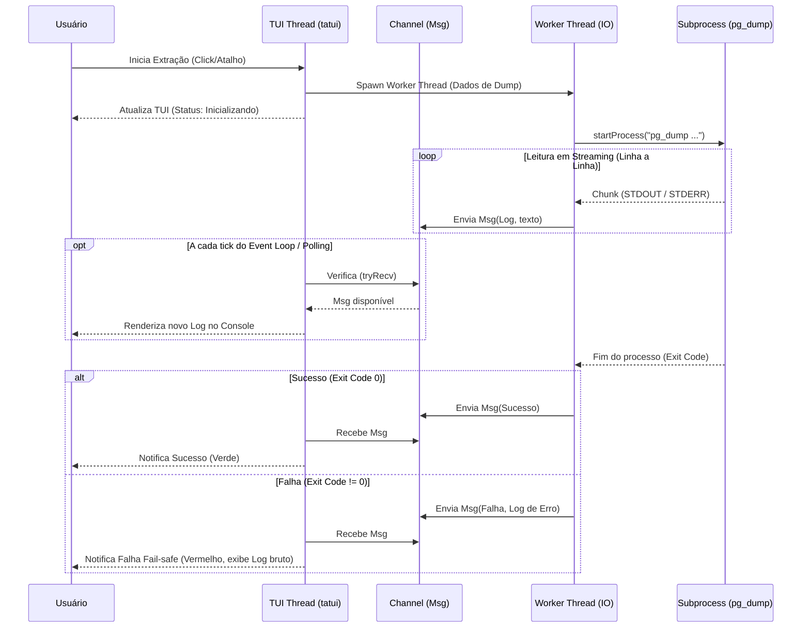

# ADR 002: Arquitetura de Interface de Terminal (TUI) e Streaming

## Status
Implementado

## Contexto
O projeto Cambalhota, sendo uma ferramenta nativa em Nim focada em controle de banco de dados, necessita de uma interface visual rica para usuários no terminal (TUI) e da capacidade de executar operações de I/O pesadas, como extração de banco de dados (`pg_dump` ou similar), sem congelar a interface. 

O Épico 2 exige a implementação de uma TUI usando o framework `tatui` da ecologia Nim, e o Épico 3 introduz a extração em streaming de bancos de dados. Quando executamos sub-processos ou fazemos leituras extensas (I/O assíncrono), o loop principal de renderização não pode ser bloqueado, do contrário a interface ficaria não-responsiva e a experiência do usuário seria degradada. Além disso, precisamos garantir um log de status transparente (promessa fail-safe), onde qualquer erro do utilitário subjacente seja exibido claramente ao usuário.

## Decisão Técnica

1. **Renderização da TUI (Framework Tatui):**
   A camada de apresentação utilizará o framework `tatui`, que oferece uma arquitetura para criar interfaces visuais no terminal. O estado da UI será mantido na thread principal, que reagirá a eventos do usuário (teclado) e mensagens de threads e processos em *background*.

2. **Concorrência e Streaming do Utilitário de Dump (`pg_dump`):**
   Para garantir que a UI se mantenha fluida durante a extração, o processamento de utilitários externos adotará a **Camada de IO Assíncrono / Multithreading**.
   - Devido às peculiaridades de frameworks de TUI de bloquear na leitura de eventos (`stdin`), utilizaremos **Threads nativas** do Nim combinadas com **Channels (`Channel[Msg]`)** para isolar as chamadas bloqueantes de processos (`osproc`) ou I/O pesado.
   - Uma *Worker Thread* inicializará o processo do `pg_dump` e lerá a saída padrão (STDOUT) e a saída de erros (STDERR) em tempo real (em *streaming*).
   - O componente de UI (Tatuí) fará *polling* não-bloqueante no *Channel* ou será notificado via eventos de loop para buscar novos "chunks" de log sem travar a interface.

3. **Log de Status Transparente (Fail-safe):**
   - A interface possuirá uma área de "Console" ou "Log de Status". Todas as saídas interceptadas via STDERR e mensagens críticas serão transmitidas ao *Channel* e renderizadas no painel em tempo real.
   - O modelo de dados armazenará o histórico parcial em um buffer para exibição (limitando a `N` linhas visíveis).
   - Caso o `pg_dump` apresente falha (exit code diferente de zero), a camada de I/O despachará um evento de `Erro Crítico`, travando o encerramento da TUI para permitir que o usuário investigue o terminal e visualize o erro original antes do desligamento.

## Diagrama de Sequência (Streaming Assíncrono com TUI)

## Trade-offs
- **Complexidade de Integração:** Usar Threads nativas com Channels em conjunção ao ARC/ORC de Nim introduz desafios com cópia profunda (`deepCopy`) de strings e estruturas de dados ao passar informações pelo canal.
- **Overhead de Renderização:** Taxas altíssimas de I/O em STDOUT do `pg_dump` podem inundar a TUI com dezenas de mensagens por segundo. A worker thread deve consolidar (*batching* / *debouncing*) ou a TUI só desenhar após processar um certo volume de eventos no mesmo ciclo.

## Consequências
- **Experiência do Usuário (UX):** A aplicação não trava/congela sob nenhuma hipótese (nem mesmo I/O de rede ou disco).
- **Rastreabilidade (Fail-safe):** Erros de banco ou configurações incorretas são imedia-tamente visíveis no painel de console da ferramenta, simplificando depurações e alinhando-se aos princípios da arquitetura.
- **Design Desacoplado:** A camada de UI fica absolutamente isolada dos mecanismos de I/O e lógica estrutural (`db_core.nim`).

## Esquema de Banco de Dados
Lembrete: Toda e qualquer comunicação/query para o banco de dados gerada por esta engine utilizará referências ao schema `Cambalhota` e nunca ao esquema `public`, seguindo as diretrizes de operação de segurança definidas na constituição do agente arquiteto.
