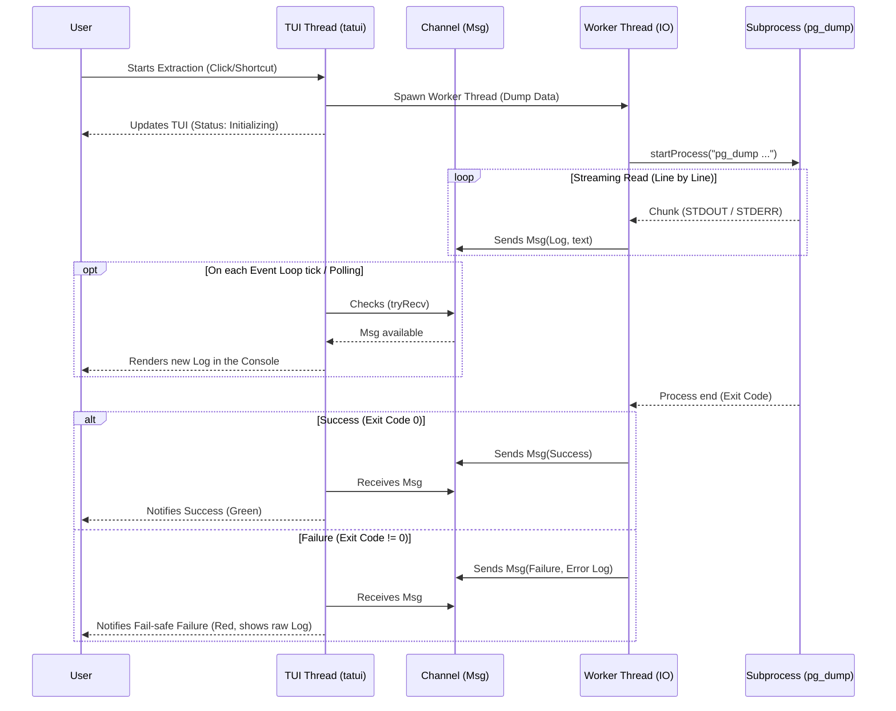

# ADR 002: Terminal User Interface (TUI) and Streaming Architecture

## Status
Implemented

## Context
The Cambalhota project, a native Nim tool focused on database control, needs a rich visual interface for terminal users (TUI) and the ability to run heavy I/O operations, such as database extraction (`pg_dump` or similar), without freezing the interface. 

Epic 2 requires a TUI built with the `tatui` framework from the Nim ecosystem, and Epic 3 introduces streaming database extraction. When we run subprocesses or perform long reads (asynchronous I/O), the main render loop must not be blocked; otherwise the interface would become unresponsive and the user experience would degrade. We also need a transparent status log (fail-safe promise), where any error from the underlying utility is shown clearly to the user.

## Technical Decision

1. **TUI Rendering (Tatui Framework):**
   The presentation layer will use the `tatui` framework, which provides an architecture for building visual interfaces in the terminal. The UI state will live in the main thread, which will react to user events (keyboard) and to messages from *background* threads and processes.

2. **Concurrency and Streaming of the Dump Utility (`pg_dump`):**
   To keep the UI fluid during extraction, processing of external utilities will adopt the **Asynchronous IO / Multithreading Layer**.
   - Because TUI frameworks tend to block while reading events (`stdin`), we will use native Nim **Threads** combined with **Channels (`Channel[Msg]`)** to isolate blocking process calls (`osproc`) or heavy I/O.
   - A *Worker Thread* will start the `pg_dump` process and read the standard output (STDOUT) and the error output (STDERR) in real time (*streaming*).
   - The UI component (Tatuí) will do non-blocking *polling* on the *Channel* or will be notified through loop events to fetch new log "chunks" without locking the interface.

3. **Transparent Status Log (Fail-safe):**
   - The interface will have a "Console" or "Status Log" area. All output intercepted via STDERR and critical messages will be sent to the *Channel* and rendered in the panel in real time.
   - The data model will keep the partial history in a display buffer (limited to `N` visible lines).
   - If `pg_dump` fails (non-zero exit code), the I/O layer will dispatch a `Critical Error` event, holding the TUI shutdown so the user can inspect the terminal and see the original error before exit.

## Sequence Diagram (Asynchronous Streaming with TUI)

## Trade-offs
- **Integration Complexity:** Using native Threads with Channels together with Nim's ARC/ORC introduces challenges with deep copies (`deepCopy`) of strings and data structures when passing information through the channel.
- **Rendering Overhead:** Very high I/O rates on `pg_dump` STDOUT can flood the TUI with dozens of messages per second. The worker thread must consolidate (*batching* / *debouncing*), or the TUI must draw only after processing a certain volume of events in the same cycle.

## Consequences
- **User Experience (UX):** The application never locks up or freezes under any circumstance (not even with network or disk I/O).
- **Traceability (Fail-safe):** Database errors or incorrect settings are immediately visible in the tool's console panel, simplifying debugging and aligning with the architecture principles.
- **Decoupled Design:** The UI layer is fully isolated from the I/O mechanisms and structural logic (`db_core.nim`).

## Database Schema
Reminder: every communication/query to the database produced by this engine will reference the `Cambalhota` schema and never the `public` schema, following the security operation guidelines defined in the architect agent's constitution.
