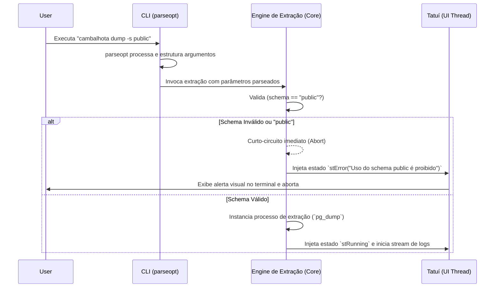

# ADR 003: CLI Parser and Security (Hard Block)

## 1. Contexto

Atualmente, o **Cambalhota** realiza a extração de dados (por exemplo, via `pg_dump`) de forma mockada e não bloqueia ativamente o uso do schema `public` do PostgreSQL (existindo apenas comentários no código desencorajando seu uso).
Para elevar a segurança, integridade estrutural e prevenir vazamento de dados indesejados ou quebra do padrão de arquitetura do projeto (onde sempre devemos usar o schema específico, nunca o `public`), é necessário implementar um parser seguro para a CLI e um mecanismo de *Hard Block*.

## 2. Decisão Técnica

1. **Parser Seguro com `parseopt`**:
   - Utilizaremos a biblioteca nativa `parseopt` do Nim para processar os argumentos de linha de comando (`-s` / `--schema`, `-u`, `-h`, etc.) antes da inicialização do extrator.
   - Isso garante que os parâmetros sejam capturados de maneira uniforme, padronizada e imune a falhas simples de indexação (ex: `os.paramStr()`).

2. **Hard Block Mechanism (Mecanismo de Validação Estrito)**:
   - A extração sofrerá *curto-circuito* (corte imediato e preventivo) caso o usuário tente passar o schema `public` (ex: `-s public`).
   - Se os parâmetros informados não passarem pela validação rigorosa (falta de argumentos obrigatórios, valores inválidos), a execução do extrator não ocorrerá.
   - O core comunicará a thread da UI Tatuí utilizando um estado de erro (`stError`) através de canais concorrentes (como definido no ADR 002), injetando o evento no *event loop* da interface e exibindo uma mensagem de segurança clara no terminal.

### Diagrama de Fluxo e Sequência (Hard Block)

## 3. Trade-offs

- **Positivo**: Proteção automática e inflexível contra erros humanos. Reforço ao padrão arquitetural (forçando o uso de schemas nominais, como o schema `Cambalhota`, no banco de dados). Processamento de CLI mais robusto.
- **Negativo**: Requer adaptação no ponto de entrada da aplicação. Aumenta sutilmente a complexidade do tratamento de erros entre o parser (linha de comando) e a TUI, visto que o erro da CLI precisa ser traduzido em um alerta visual na TUI antes de encerrar o programa, ou abortar o sub-comando.

## 4. Consequências

- A substituição da execução "mockada" de `pg_dump` por uma rotina real exigirá esta validação prévia.
- Qualquer automação ou CI/CD que, por ventura, tentar operar sobre o schema `public` usando a ferramenta irá falhar de imediato, assegurando conformidade contínua.

## 5. Status

**Implementado**
