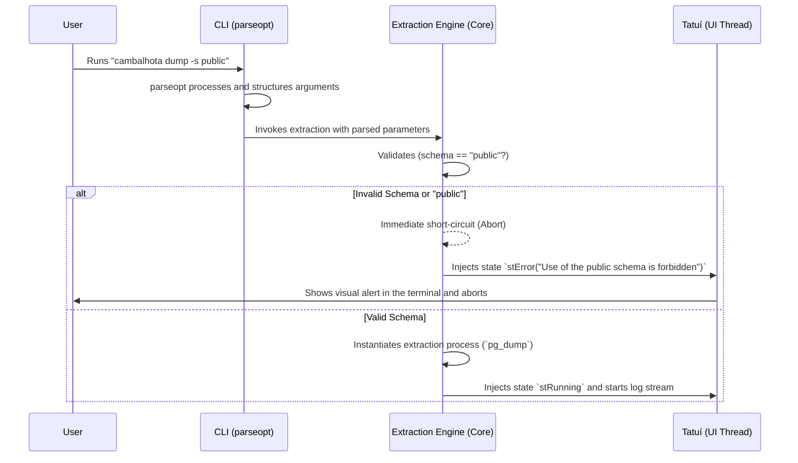

# ADR 003: CLI Parser and Security (Hard Block)

## 1. Context

Currently, **Cambalhota** performs data extraction (for example, via `pg_dump`) in a mocked way and does not actively block the use of the PostgreSQL `public` schema (there are only code comments discouraging its use).
To raise security and structural integrity, and to prevent unwanted data leaks or breaking the project's architecture standard (where we must always use the specific schema, never `public`), we need a safe CLI parser and a *Hard Block* mechanism.

## 2. Technical Decision

1. **Safe Parser with `parseopt`**:
   - We will use Nim's native `parseopt` library to process the command-line arguments (`-s` / `--schema`, `-u`, `-h`, etc.) before the extractor starts.
   - This ensures parameters are captured in a uniform, standardized way, immune to simple indexing failures (e.g., `os.paramStr()`).

2. **Hard Block Mechanism (Strict Validation Mechanism)**:
   - The extraction will *short-circuit* (immediate, preventive cut) if the user tries to pass the `public` schema (e.g., `-s public`).
   - If the given parameters do not pass strict validation (missing required arguments, invalid values), the extractor will not run.
   - The core will notify the Tatuí UI thread with an error state (`stError`) through concurrent channels (as defined in ADR 002), injecting the event into the interface *event loop* and showing a clear security message in the terminal.

### Flow and Sequence Diagram (Hard Block)

## 3. Trade-offs

- **Positive**: Automatic, inflexible protection against human error. Reinforces the architecture standard (forcing the use of named schemas, such as the `Cambalhota` schema, in the database). More robust CLI processing.
- **Negative**: Requires changes at the application entry point. Slightly increases the complexity of error handling between the parser (command line) and the TUI, since the CLI error must be translated into a visual alert in the TUI before the program exits, or the subcommand must be aborted.

## 4. Consequences

- Replacing the "mocked" `pg_dump` execution with a real routine will require this prior validation.
- Any automation or CI/CD that tries to operate on the `public` schema using the tool will fail immediately, ensuring continuous compliance.

## 5. Status

**Implemented**
