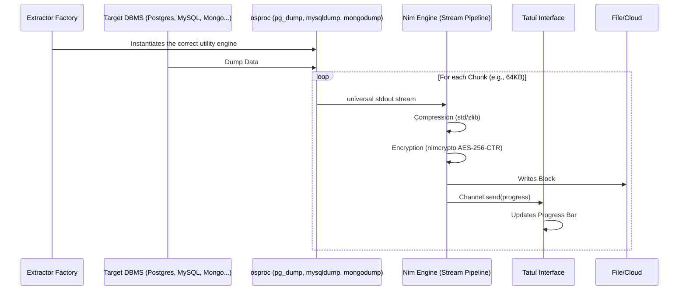

# ADR 004: On-the-fly Streaming, Compression and Encryption of Dumps

## 1. Context

Generating structural backups or full database dumps can produce files in the gigabyte or terabyte range. If the Cambalhota engine tries to load the whole database dump into RAM before processing it or writing it to disk, the application becomes highly prone to Out-Of-Memory (OOM) failures.

Besides the memory constraint, dumps contain sensitive data and take up a lot of disk space and bandwidth when sent to remote storage (S3, Git, etc.). Therefore, both compression and encryption must be applied to the output payload, without compromising system stability or locking the user interface (TUI).

## 2. Technical Decision

To address the RAM limit and the security requirements, we define that the database extraction process will run under the **Streaming with Pipeline Processing (On-the-fly)** pattern. 

### 2.1. Interception and Chunked Reads via Extractor Adapter / Factory
The architecture must not be coupled to a single database utility. To transparently support multiple DBMSs (PostgreSQL, Oracle, MSSQL, MySQL, SQLite, SPANNER, MongoDB, BigQuery, etc.), we will use the **Extractor Adapter / Factory Pattern**.
The Nim engine will dynamically resolve, based on the connection (connection string) or CLI flags, which engine to instantiate in `osproc` (`pg_dump`, `mysqldump`, `mongodump` or another binary).
Instead of waiting for the process to finish or reading the full output, the pipeline will intercept the universal standard output (`stdout`) of the child process and read it continuously, using fixed buffers (chunks/streams). This keeps memory usage constant and the flow agnostic to the database.

### 2.2. On-the-fly Compression
The intercepted stream will be compressed in real time. The tool will use the native `std/zlib` library (or an equivalent library such as `zstd` via binding) to compress (e.g., GZIP or Deflate algorithm) each chunk read, drastically reducing the size of the data in memory before it is passed to the next stage.

### 2.3. E2E Encryption
After the chunk is compressed, the data will go through an on-the-fly encryption stage. We will use the `nimcrypto` library, applying the standard **AES-256** algorithm in **CTR** (Counter Mode) or **CBC** (with proper padding) mode. CTR mode is strongly recommended because it allows encryption perfectly aligned with stream behavior (block by block), with no need to accumulate data to fill whole blocks (padding) before encrypting, which optimizes the flow.

### 2.4. Communication and Visual Progress (TUI)
This whole heavy pipeline (Read -> Compression -> Encryption -> Write to Disk/Cloud) will run in a *worker thread* separate from the interface. Every `N` processed blocks, the thread will send structured messages (e.g., bytes read/processed) through `Channel[Msg]` to the main thread.
The Tatuí TUI will consume these messages without blocking (using `tryRecv`) and smoothly update visual components, such as continuous progress bars, providing responsive extraction feedback.

## 3. Trade-offs

- **Positive:**
  - `O(1)` memory usage relative to the database size, making OOM errors impossible.
  - Improved security (E2E encryption).
  - Substantial savings in network I/O and storage space (on-the-fly compression).
- **Negative:**
  - Additional computational (CPU) overhead split among the database (which produces the dump), compression and encryption.
  - Greater architectural complexity when orchestrating streams and concurrent threads.

## 4. Consequences

- The stream pipeline must be developed and rigorously tested to make sure no data is lost at chunk boundaries.
- Encryption keys will need to be managed and provided through environment variables, secure settings or secure prompts in the TUI.
- No extraction code may be approved if it reads `stdout` in full (e.g., using methods such as `readAll()`). Code review must veto approaches that break streaming.

## 5. Status

**Implemented**

## 6. Flow Diagram

