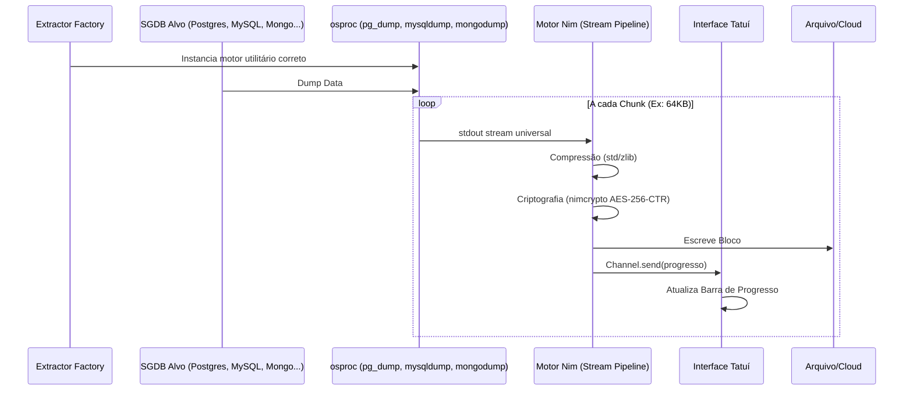

# ADR 004: Streaming, Compressão e Criptografia On-the-fly de Dumps

## 1. Contexto

A geração de backups estruturais ou dumps completos de bancos de dados pode resultar em arquivos na ordem de gigabytes ou terabytes. Caso o motor do Cambalhota tente carregar todo o dump do banco de dados na memória RAM antes de processá-lo ou gravá-lo no disco, a aplicação ficará altamente suscetível a falhas do tipo Out-Of-Memory (OOM).

Além da restrição de memória, dumps contêm dados sensíveis e ocupam grande espaço em disco e largura de banda quando enviados para o armazenamento remoto (S3, Git, etc.). Sendo assim, é necessário aplicar tanto a compressão quanto a criptografia no payload de saída, sem comprometer a estabilidade do sistema ou travar a interface do usuário (TUI).

## 2. Decisão Técnica

Para endereçar a questão do limite de RAM e os requisitos de segurança, definimos que o processo de extração do banco operará sob o padrão de **Streaming com Processamento em Pipeline (On-the-fly)**. 

### 2.1. Interceptação e Leitura em Chunks via Extractor Adapter / Factory
A arquitetura não deve estar acoplada a um único utilitário de banco de dados. Para suportar de forma transparente múltiplos SGDBs (PostgreSQL, Oracle, MSSQL, MySQL, SQLite, SPANNER, MongoDB, BigQuery, etc.), utilizaremos o **Extractor Adapter / Factory Pattern**.
O motor em Nim resolverá dinamicamente, baseado na conexão (connection string) ou flags do CLI, qual motor instanciar no `osproc` (seja `pg_dump`, `mysqldump`, `mongodump`, ou outro binário).
Em vez de esperar o término do processo ou ler a saída completa, o pipeline interceptará a saída padrão universal (`stdout`) do processo filho e efetuará a leitura de forma contínua, utilizando buffers fixos (chunks/streams). Isso garante que o uso de memória permaneça constante e o fluxo permaneça agnóstico ao banco de dados.

### 2.2. Compressão On-the-fly
O stream interceptado será comprimido em tempo real. A ferramenta utilizará a biblioteca nativa `std/zlib` (ou biblioteca equivalente como `zstd` via binding) para realizar a compressão (ex: algoritmo GZIP ou Deflate) a cada chunk lido, reduzindo drasticamente o tamanho do dado em memória antes de ser passado para o próximo estágio.

### 2.3. Criptografia E2E
Após a compressão do chunk, os dados passarão por um estágio de criptografia on-the-fly. Utilizaremos a biblioteca `nimcrypto`, aplicando o algoritmo padrão **AES-256** no modo de operação **CTR** (Counter Mode) ou **CBC** (com padding adequado). O modo CTR é fortemente recomendado por permitir criptografia perfeitamente alinhada com o comportamento de streams (bloco a bloco), sem a necessidade de acumular dados para preencher blocos inteiros (padding) antes de cifrar, otimizando o fluxo.

### 2.4. Comunicação e Progresso Visual (TUI)
Todo esse pipeline pesado (Leitura -> Compressão -> Criptografia -> Gravação no Disco/Nuvem) rodará em uma *worker thread* separada da interface. A cada `N` blocos processados, a thread enviará mensagens estruturadas (ex: bytes lidos/processados) através de `Channel[Msg]` para a thread principal.
A TUI Tatuí consumirá essas mensagens sem bloqueios (usando `tryRecv`) e atualizará fluidamente componentes visuais, como barras de progresso contínuas, oferecendo feedback responsivo da extração.

## 3. Trade-offs

- **Positivos:**
  - Uso de memória `O(1)` em relação ao tamanho do banco de dados, impossibilitando erros de OOM.
  - Segurança aprimorada (Criptografia E2E).
  - Economia substancial de I/O de rede e espaço de armazenamento (Compressão on-the-fly).
- **Negativos:**
  - Sobrecarga computacional (CPU) adicional dividida entre o banco de dados (que faz o dump), a compressão e a criptografia.
  - Maior complexidade arquitetural ao lidar com a orquestração de streams e threads concorrentes.

## 4. Consequências

- Será necessário desenvolver e testar rigorosamente o pipeline de streams para certificar que nenhum dado se perca nos limites dos chunks.
- Chaves de criptografia precisarão ser gerenciadas e fornecidas via variáveis de ambiente, configurações seguras ou prompts seguros na TUI.
- Nenhum código de extração poderá ser aprovado caso faça leitura integral da `stdout` (ex: uso de métodos como `readAll()`). O code review deve vetar abordagens que desrespeitem o streaming.

## 5. Status

**Implementado**

## 6. Diagrama de Fluxo

