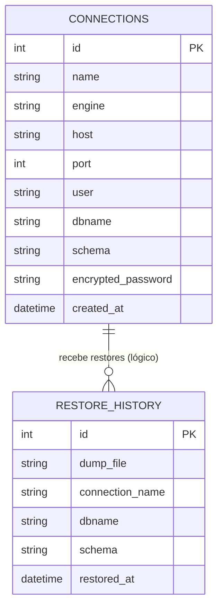

# ADR 005: UX/QoL and Audit Trail for Restore Operations

## 1. Contexto
O Produto definiu três novas obrigações de UX e Qualidade de Vida (QoL) com foco em Governança para o Cambalhota v1.1.0:
1. **Histórico de Restores**: Manter um registro local de todos os backups restaurados.
2. **Listagem de Conexões Intuitiva**: Formatar a exibição de conexões na TUI de forma mais legível.
3. **Localização de Backups**: Indicar a origem dos arquivos de dump listados na TUI.

## 2. Decisão Técnica

Para atender a esses requisitos, as seguintes mudanças arquiteturais e de código devem ser implementadas:

### 2.1. Estrutura do Histórico de Restores (`src/db/storage.nim`)
Devemos adicionar uma nova tabela `restore_history` ao banco de dados SQLite local na função `initDb()`. A query de criação será:

```sql
CREATE TABLE IF NOT EXISTS restore_history (
  id INTEGER PRIMARY KEY AUTOINCREMENT,
  dump_file TEXT NOT NULL,
  connection_name TEXT NOT NULL,
  dbname TEXT NOT NULL,
  schema TEXT NOT NULL,
  restored_at DATETIME DEFAULT CURRENT_TIMESTAMP
);
```

> **Nota Arquitetural**: Conforme as regras de governança de esquema do PostgreSQL, o esquema padrão ou de referência deve ser sempre `Cambalhota` e nunca `public`.

### 2.2. Formatação e Layout da TUI (`src/tui/app.nim`)
1. **Listagem de Conexões**: A renderização da string do `ListItem` para as conexões passará de uma string concatenada bruta para o formato intuitivo:
   ```nim
   "[ " & toUpperAscii(c.engine) & " ] DB: " & c.dbname & " | SCHEMA: " & c.schema
   ```
   *(Exemplo renderizado: `[ PG ] DB: meu_banco | SCHEMA: Cambalhota`)*

2. **Localização de Backups**: A listagem de dumps (arquivos de backup) será formatada para incluir o identificador físico de origem local:
   ```nim
   "[LOCAL] " & d.extractFilename()
   ```

3. **Nova Aba de Histórico**: O histórico de restores será exibido em uma nova aba no menu superior. Atualizaremos a lista de abas (tabs) para incluir:
   ```nim
   let menuItems = @[" 1. Config ", " 2. Backup ", " 3. Restore ", " 4. History "]
   ```
   A navegação e a lógica de renderização em `app.nim` (variável `selectedMenu == 3`) devem exibir um novo componente de lista `listStHistory` carregando os registros da tabela `restore_history`.

### 2.3. Diagrama de Relacionamento de Entidades (ER)



## 3. Trade-offs
- **Armazenamento Local**: O uso do SQLite local no diretório `~/.cambalhota/` mantém o registro atrelado à máquina em que o comando foi executado. Restores feitos em máquinas diferentes não compartilharão histórico.
- **Acoplamento na TUI**: Adicionar uma nova aba aumenta ligeiramente a complexidade do loop de eventos principal em `app.nim`.

## 4. Consequências
- Os usuários terão rastreabilidade imediata do que foi restaurado e quando.
- A interface de usuário será muito mais limpa com a formatação padronizada para conexões e origem de backups.
- Facilidade em auditorias locais sobre quem conectou e restaurou backups em quais bancos e esquemas (ex: `Cambalhota`).

## 5. Status
**Aprovado** - Pronto para execução tática.
