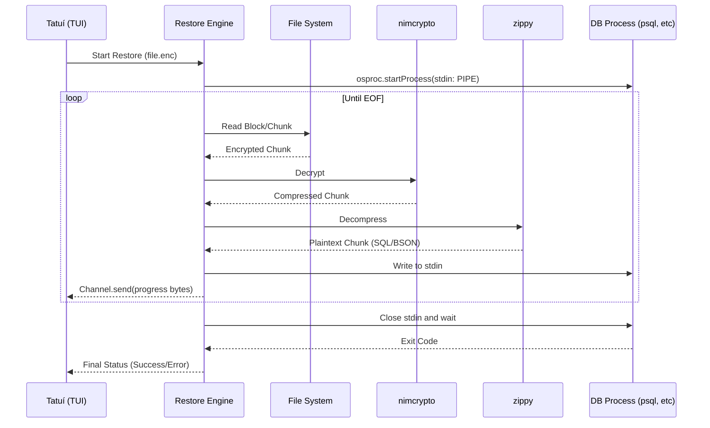

# ADR 005: Restore Engine, Anti-OOM Reverse Mechanics and Local Listing

## Context
Within the scope of Epic 3 (Restore), Cambalhota needs to show the user the list of previously extracted backups and manage the restore process into the target databases.
The extraction files are stored locally, encrypted, under the `~/.cambalhota/db_dumps/YYYY/` directory.
The restore flow must be designed so the user interface (TUI - Tatuí) stays fluid during listing and so the backup file is injected into the database in a fully optimized way (Anti-OOM), using streaming data processing instead of loading huge files into memory.

## Technical Decision
To meet the technical requirements in the Nim language, the following architecture was defined:

### 1. Local Listing (Tatuí TUI)
- Scanning the backup directories in `~/.cambalhota/db_dumps/YYYY/` must happen **asynchronously**.
- We will use the asynchronous I/O library adopted by the project (such as `chronos` or the standard `asyncdispatch` module together with workers) to read in the background without blocking the TUI render loop (Nim/Illwill, for example).
- To avoid interruptions, results will be cached/paginated when there is an excessively large number of files.

### 2. Reverse Mechanics (Anti-OOM Restore Engine)
To read large files and restore them without causing Out of Memory (OOM), we will use a block-oriented pipeline approach:

- **Execution Factory:** Once the user picks the `.enc` file, the application identifies the database engine (through the architecture mapping) and calls a Factory to build the appropriate command (e.g., `psql`, `mysql`, `mongorestore`). The process is instantiated through Nim's `osproc` module with stream redirection, in particular configuring standard input (`stdin`) for continuous reading.
- **Chunking Pipeline:** The `.enc` file is read from disk through fixed-size buffers.
- **Streaming Decryption and Decompression:** Each chunk read goes through the following consecutive in-memory steps:
  1. The `nimcrypto` engine, to decrypt the block.
  2. The `zippy` engine, for decompression.
- **Injection into `stdin`:** The plain text result of this chunk is then injected directly into the standard input stream of the restore process instantiated earlier.
- **Responsive Telemetry:** On each iteration of this chunk processing loop, a notification with the current progress in bytes will be sent (through channels) to the main thread/TUI, allowing a smooth, immediate progress bar.

### Architecture Diagram (Reverse Mechanics)

## Trade-offs
- **Zippy Streaming Complexity:** Doing streaming decompression (chunk by chunk) without failures requires careful control of the `zippy` package read boundaries. Small residual buffers may be needed to handle chunks where the compressed byte was split.
- **Process Support for `stdin` Ingestion:** Some utilities and drivers behave differently when input is injected via `stdin`. This will require fine tuning of command flags depending on the Engine (e.g., ignoring password prompts or forcing batch mode in mysql).

## Consequences
- Memory consumption stays flat at O(1), strictly limited to the size of the allocated chunk buffer, whether the .enc file is 100MB or 500GB.
- The user experience with the progress bar in the TUI will be highly responsive and reliable.

## Status
Implemented
