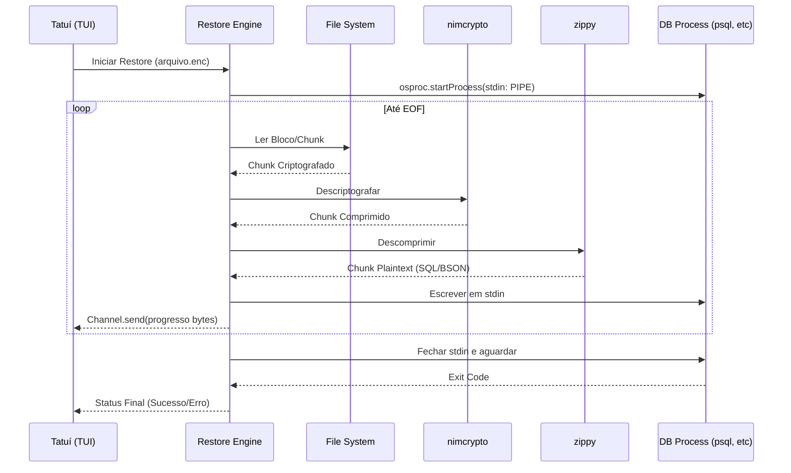

# ADR 005: Engine de Restore, Mecânica Reversa Anti-OOM e Listagem Local

## Contexto
No escopo do Épico 3 (Restore), o Cambalhota necessita apresentar ao usuário a lista de backups previamente extraídos e gerenciar o processo de restauração para os bancos de dados de destino.
Os arquivos de extração encontram-se localmente criptografados sob o diretório `~/.cambalhota/db_dumps/YYYY/`.
O fluxo de restauração deve ser projetado para garantir que a interface do usuário (TUI - Tatuí) permaneça fluida durante a listagem e que a injeção do arquivo de backup no banco de dados ocorra de maneira totalmente otimizada (Anti-OOM), utilizando processamento de dados por fluxo (streaming) em vez de carregar arquivos imensos em memória.

## Decisão Técnica
Para atender aos requisitos técnicos na linguagem Nim, foi definida a seguinte arquitetura:

### 1. Listagem Local (TUI Tatuí)
- A varredura dos diretórios de backup em `~/.cambalhota/db_dumps/YYYY/` deverá ocorrer de forma **assíncrona**.
- Utilizaremos a biblioteca de I/O assíncrona adotada pelo projeto (como `chronos` ou o módulo padrão `asyncdispatch` em conjunto com workers) para realizar leituras em background sem bloquear o render loop da TUI (Nim/Illwill, por exemplo).
- Para evitar interrupções, os resultados serão cacheados/paginados caso haja um número excessivamente elevado de arquivos.

### 2. Mecânica Reversa (Restore Engine Anti-OOM)
Para que seja possível ler arquivos grandes e restaurá-los sem causar Out of Memory (OOM), utilizaremos uma abordagem de pipeline orientada a blocos:

- **Factory de Execução:** Uma vez que o usuário escolhe o arquivo `.enc`, a aplicação identifica o motor de banco de dados (por meio do mapeamento arquitetural) e invoca um Factory para gerar o comando apropriado (ex: `psql`, `mysql`, `mongorestore`). O processo é instanciado via módulo `osproc` do Nim, com o redirecionamento dos fluxos, especialmente configurando a entrada padrão (`stdin`) para leitura contínua.
- **Pipeline de Chunking:** O arquivo `.enc` é lido do disco através de buffers de tamanho fixo.
- **Descriptografia e Descompressão por Fluxo:** Cada bloco (chunk) lido passa pelas seguintes etapas consecutivas em memória:
  1. Passagem pelo motor `nimcrypto` para realizar a decifragem do bloco.
  2. Passagem pelo motor `zippy` para descompressão.
- **Injeção em `stdin`:** O resultado em texto claro (plain text) desse chunk é então injetado diretamente no fluxo da entrada padrão do processo de restore instanciado anteriormente.
- **Telemetria Responsiva:** A cada iteração deste loop de processamento de chunk, uma notificação contendo o progresso atual em bytes será enviada (através de channels) à thread principal/TUI, permitindo a exibição de uma barra de progresso suave e imediata.

### Diagrama Arquitetural (Mecânica Reversa)

## Trade-offs
- **Complexidade do Streaming Zippy:** Fazer a descompressão de streaming (chunk a chunk) sem falhas exige controle cuidadoso das bordas de leitura do pacote `zippy`. Pode ser necessário manter pequenos buffers residuais para tratar chunks onde o byte comprimido se dividiu.
- **Suporte de Processos para Ingestão `stdin`:** Certos utilitários e drivers comportam-se diferentemente quando a entrada é injetada por `stdin`. Exigirá tuning fino nas flags dos comandos dependendo da Engine (ex: ignorar prompts de password ou forçar modo de batch no mysql).

## Consequências
- A memória consumida permanece achatada O(1), estritamente limitada ao tamanho do buffer de chunk alocado, independentemente de o arquivo .enc ter 100MB ou 500GB.
- A experiência de usuário com a barra de progresso na TUI será altamente responsiva e confiável.

## Status
Implementado
