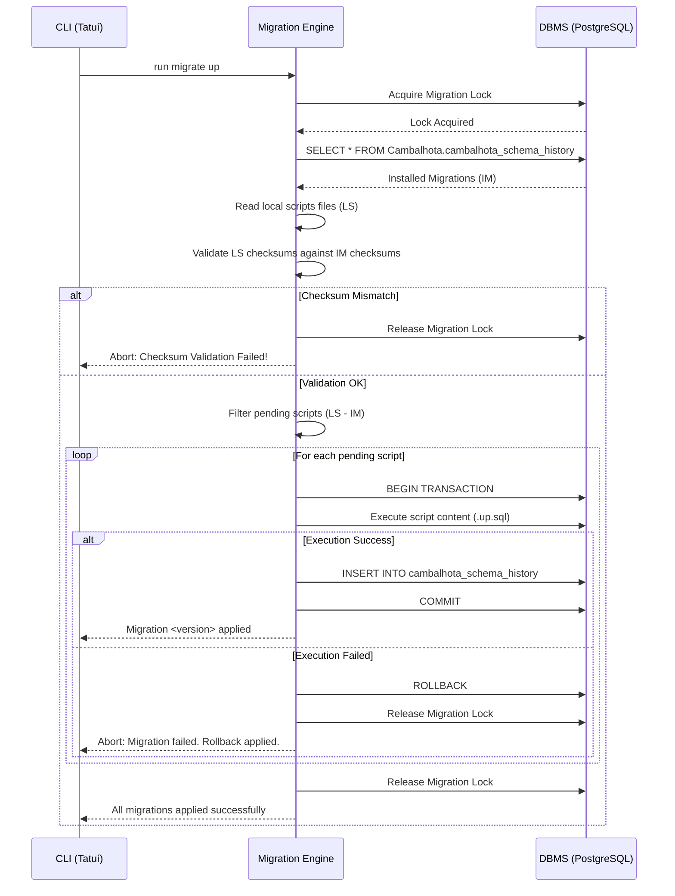

# ADR 006: Migration Engine Core Architecture

## 1. Context
With the approval of Epic 4, we need to establish the base architecture of the *Migration Engine* in the Cambalhota system. Cambalhota will act as structural version control for databases, orchestrating schema evolution in a deterministic and safe way. Since it is built in Nim, we need to define how scripts are versioned, how we ensure atomicity when applying them and how we audit the change history, preventing structural corruption caused by concurrent executions or tampered scripts.

## 2. Technical Decision

### 4.1. Artifact Format
Migration scripts will follow a strict naming convention to ensure chronological ordering and clear identification.
The adopted pattern is: `V<timestamp>__<description>.[up|down].sql`
- **Examples:**
  - `V20260717162000__create_users_table.up.sql`
  - `V20260717162000__create_users_table.down.sql`
- **Rationale:** Using *timestamps* (format `YYYYMMDDHHMMSS`) greatly minimizes collisions in concurrent development environments, unlike simple sequential numbering. The `.up.sql` and `.down.sql` suffixes unambiguously separate the apply and rollback logic.

### 4.3. Transactional Mechanisms and Concurrency
- **Agnostic Transactional Scope:** Each structural script (`.up.sql` or `.down.sql`) will be dynamically wrapped by the *Engine* in transaction blocks (injecting `BEGIN` and `COMMIT`). If any error happens during execution, the *Engine* will trigger a `ROLLBACK`, ensuring the database is not left in an inconsistent state. Analytical tools and DDLs that do not support native transactions in the DBMS must be handled in a custom way (e.g., a directive at the top of the file).
- **Locking and Concurrency:** To prevent two Tatuí (CLI) instances or CI/CD runs from applying migrations at the same time (which would corrupt the topology), we will implement a *Locking* system. On PostgreSQL, we will use session-level *Advisory Locks* or inserts into a global *lock* table, ensuring exclusive execution during the migration flow.

### 4.4. Audit and Integrity Table (Checksumming)
The engine will strictly track the database state through a metadata table.
- **Table:** `Cambalhota.cambalhota_schema_history`
- **Structure (Logical DDL):**
  ```sql
  CREATE SCHEMA IF NOT EXISTS Cambalhota;

  CREATE TABLE Cambalhota.cambalhota_schema_history (
      installed_rank INT PRIMARY KEY,
      version VARCHAR(50) NOT NULL UNIQUE,
      description VARCHAR(200) NOT NULL,
      type VARCHAR(20) NOT NULL,
      script VARCHAR(1000) NOT NULL,
      checksum VARCHAR(256),
      installed_by VARCHAR(100) NOT NULL,
      installed_on TIMESTAMP DEFAULT CURRENT_TIMESTAMP,
      execution_time_ms INT NOT NULL,
      success BOOLEAN NOT NULL
  );
  ```
- **Checksumming:** When a script is read locally to be applied, the *Engine* computes the cryptographic *hash* (e.g., SHA-256) of the exact file content. Before running any new migration, the system validates all already-installed scripts against the *checksums* stored in `cambalhota_schema_history`. If a script that was already applied to the database is physically changed in the file system, validation fails and the engine blocks the execution, reporting the drift and ensuring immunity against retroactive tampering.

## 3. Process Diagram (Migrate Up)



## 4. Trade-offs and Consequences
- **Positive:** High level of safety in versioning; prevention of race conditions; and immutable metadata auditing.
- **Negative:** *Checksum* failures in development environments (where devs often iterate on the same local file) will require an explicit command to recompute (e.g., `repair`). 
- **Consequence:** Engineering (Nim development) will need to abstract the connection interface to support clean injection of transaction control when interpreting local scripts.

## 5. Status
**Status:** Implemented
