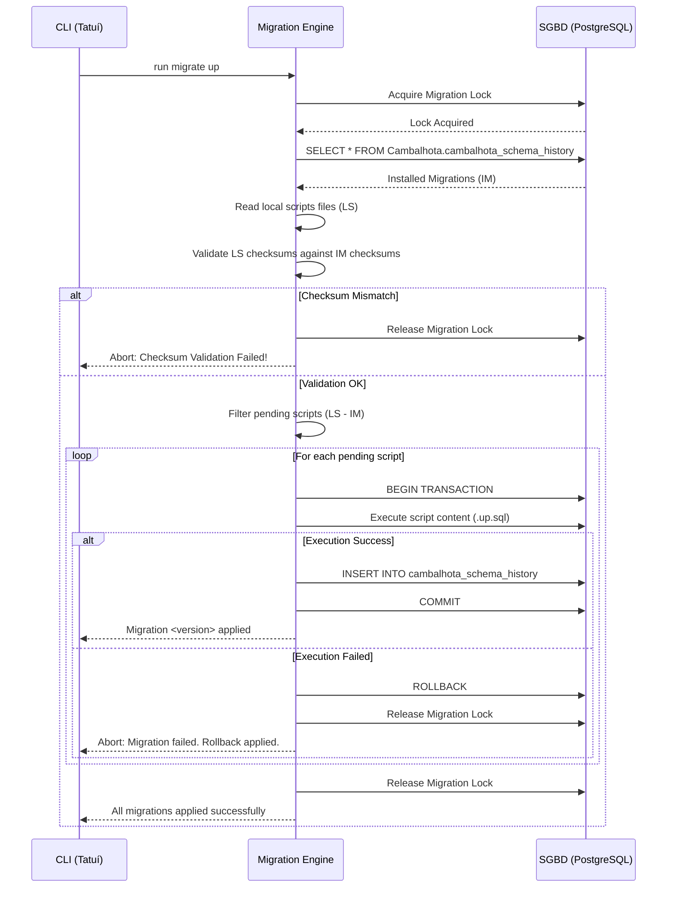

# ADR 006: Migration Engine Core Architecture

## 1. Contexto
Com a aprovação do Épico 4, surge a necessidade de estabelecer a arquitetura base da *Migration Engine* no sistema Cambalhota. O Cambalhota atuará como um controle de versão estrutural para bancos de dados, orquestrando a evolução de esquemas de forma determinística e segura. Sendo construído em Nim, precisamos definir como os scripts são versionados, como garantimos atomicidade nas aplicações e como auditamos o histórico de mudanças, prevenindo corrupção estrutural devido a execuções concorrentes ou scripts adulterados.

## 2. Decisão Técnica

### 4.1. Formato dos Artefatos
Os scripts de migração seguirão uma nomenclatura rígida para garantir ordenação cronológica e identificação clara.
O padrão adotado é: `V<timestamp>__<descricao>.[up|down].sql`
- **Exemplos:**
  - `V20260717162000__create_users_table.up.sql`
  - `V20260717162000__create_users_table.down.sql`
- **Justificativa:** O uso de *timestamps* (formato `YYYYMMDDHHMMSS`) minimiza severamente colisões em ambientes de desenvolvimento concorrente, em contraste com numeração sequencial simples. Os sufixos `.up.sql` e `.down.sql` separam inequivocamente as lógicas de aplicação e reversão.

### 4.3. Mecanismos Transacionais e Concorrência
- **Escopo Transacional Agnostico:** Cada script estrutural (`.up.sql` ou `.down.sql`) será envolvido dinamicamente pela *Engine* em blocos transacionais (injetando `BEGIN` e `COMMIT`). Se ocorrer qualquer erro durante a execução, a *Engine* acionará um `ROLLBACK`, assegurando que o banco não permaneça em estado inconsistente. Ferramentas analíticas e DDLs que não suportam transações nativas no SGBD deverão ser tratadas de forma customizada (ex: diretiva no topo do arquivo).
- **Locking e Concorrência:** Para prevenir que duas instâncias do Tatuí (CLI) ou execuções via CI/CD tentem aplicar migrações simultaneamente (o que corromperia a topologia), implementaremos um sistema de *Locking*. Em PostgreSQL, faremos uso de *Advisory Locks* a nível de sessão ou inserções em uma tabela de *lock* global garantindo exclusividade de execução durante o fluxo de migração.

### 4.4. Tabela de Auditoria e Integridade (Checksumming)
A engine fará o rastreio rigoroso do estado do banco através de uma tabela de metadados.
- **Tabela:** `Cambalhota.cambalhota_schema_history`
- **Estrutura (DDL Lógica):**
  ```sql
  CREATE SCHEMA IF NOT EXISTS Cambalhota;

  CREATE TABLE Cambalhota.cambalhota_schema_history (
      installed_rank INT PRIMARY KEY,
      version VARCHAR(50) NOT NULL UNIQUE,
      description VARCHAR(200) NOT NULL,
      type VARCHAR(20) NOT NULL,
      script VARCHAR(1000) NOT NULL,
      checksum VARCHAR(256),
      installed_by VARCHAR(100) NOT NULL,
      installed_on TIMESTAMP DEFAULT CURRENT_TIMESTAMP,
      execution_time_ms INT NOT NULL,
      success BOOLEAN NOT NULL
  );
  ```
- **Checksumming:** No momento em que um script é lido localmente para ser aplicado, a *Engine* calcula o *hash* criptográfico (ex: SHA-256) do conteúdo exato do arquivo. Antes de executar qualquer migração nova, o sistema valida todos os scripts já instalados contra os *checksums* armazenados em `cambalhota_schema_history`. Se um script que já foi aplicado no banco sofrer alteração física no sistema de arquivos, a validação falhará e a engine bloqueará a execução alertando o desvio, garantindo imunidade contra adulterações retroativas.

## 3. Diagrama do Processo (Migrate Up)



## 4. Trade-offs e Consequências
- **Positivos:** Alto grau de segurança no versionamento; prevenção de condições de corrida; e auditoria imutável dos metadados.
- **Negativos:** Falhas de *checksum* em ambientes de desenvolvimento (quando devs costumam iterar no mesmo arquivo local) exigirão um comando explícito para re-calcular (ex: `repair`). 
- **Consequência:** A Engenharia (desenvolvimento em Nim) precisará abstrair a interface de conexão para suportar injeções limpas do controle transacional ao interpretar os scripts locais.

## 5. Status
**Status:** Implementado
