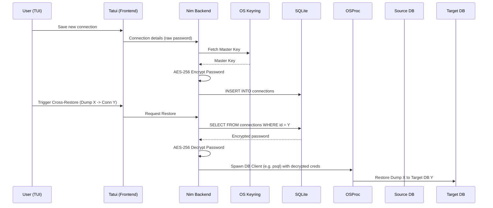

# ADR 007: SQLite Multi-Connections and UX Refinement

## Context
Cambalhota v1.0.1 introduces management of multiple database connections directly through the TUI, removing the dependency on `.env` files to store credentials. The need to back up from one source and restore into different targets (cross-database restore) requires a new local persistence approach, using SQLite with encryption, and an update to the user interface.

## Technical Decision

### 1. Local Storage Structure (SQLite)
The application will use a local SQLite database located at `~/.cambalhota/connections.db`. The connections table structure will be:

```sql
CREATE TABLE connections (
    id INTEGER PRIMARY KEY AUTOINCREMENT,
    name TEXT NOT NULL UNIQUE,
    engine TEXT NOT NULL, -- e.g.: pg, mysql
    host TEXT NOT NULL,
    port INTEGER NOT NULL,
    username TEXT NOT NULL,
    password_encrypted TEXT NOT NULL,
    schema TEXT NOT NULL,
    created_at DATETIME DEFAULT CURRENT_TIMESTAMP
);
```
*(Note: The PostgreSQL schema/table must keep referencing `Cambalhota` and never `public`, according to the architecture rules).*

### 2. Password Encryption (AES via `nimcrypto`)
Database passwords will be encrypted before being stored in SQLite. Encryption will use AES-256 (CTR or CBC with a unique random IV per record) through the `nimcrypto` library in Nim.

**Master Key Management:**
The master key for encryption and decryption (AES Key) will not be hardcoded. It will be derived securely using the native operating system *keyring / credential manager* (such as `Secret Service` on Linux, `Keychain` on macOS or `Credential Locker` on Windows). The application retrieves the Master Key through the native keyring and then decrypts the credentials from SQLite. If keyring integration is not available, a "Master Password" requested at tool startup may be adopted.

### 3. 'Cross-Database Restore' Abstraction (via `osproc`)
To allow cross restores, the application will use Nim's `osproc` library to orchestrate the processes.

- **Backup (Source):** The application fetches the "Source" connection from SQLite, decrypts the password and passes the data to the native CLI call (e.g., `pg_dump`). To avoid leaking credentials in logs, the decrypted password must be passed through an environment variable of the process injected by `osproc` (such as `PGPASSWORD`) or through a restricted temporary file (such as `.pgpass`).
- **Cross Restore (Target):** The application will take the selected dump from the local machine and apply it to the "Target" connection, again retrieving and decrypting the corresponding credential, and invoking the native utility (e.g., `psql` for PostgreSQL or `mysql` for MySQL) through `osproc`, passing the dump file via `stdin`.

### 4. UI Components (`tatui` Library)
The `tatui` library will be refactored to adopt the new visual and UX flow requirements:
- **Visual Identity:** The Retrowave Logo (ASCII) will be attached as a static `Label` (or a similar text layout component) in the top-left block of the main Frame/Screen, acting as the global Header together with a status bar on the right showing metrics from the `connections` table.
- **Side-by-side Menu (Cross-Restore):** In the Restore tab, the `tatui` library will use a `HorizontalLayout` (or an equivalent grid system) that splits the UI into two parallel panels:
  - **Left ("What?"):** A selectable list of extracted Dumps (files).
  - **Right ("Where to?"):** A combobox/list with the connections registered in SQLite, to choose the Target.
  - Confirmation will only be enabled after both are selected, cognitively reinforcing the Source -> Target flow.

### Architecture Diagram (Sequence)


## Trade-offs
- **Keystore Complexity:** Using the native (OS) keyring to protect the master key adds complexity and possible cross-platform compatibility issues (requiring fallbacks such as asking for the password when the app opens).
- **Ongoing Dependency on the Client CLI:** Using `osproc` keeps Cambalhota coupled to external binaries of the host system (`pg_dump`, `mysql`), limiting full portability if the OS does not have them in the PATH.

## Consequences
- The `.env` file is replaced by centralizing all credentials in SQLite with AES encryption.
- A visually improved interface with parallel panels in `tatui`, bringing a robust UX for moving between sources and targets.

## Status
Implemented
