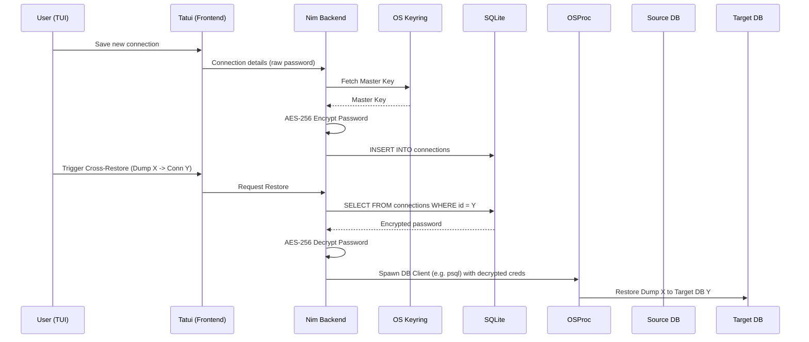

# ADR 007: SQLite Multi-Connections and UX Refinement

## Contexto
O Cambalhota v1.0.1 introduz o gerenciamento de múltiplas conexões de banco de dados diretamente através da TUI, eliminando a dependência de arquivos `.env` para armazenamento de credenciais. A necessidade de backups de uma origem e restaurações em diferentes destinos (cross-database restore) exige uma nova abordagem de persistência local, utilizando SQLite com criptografia, e uma atualização na interface do usuário.

## Decisão Técnica

### 1. Estrutura de Armazenamento Local (SQLite)
A aplicação utilizará um banco de dados local SQLite localizado em `~/.cambalhota/connections.db`. A estrutura da tabela de conexões será a seguinte:

```sql
CREATE TABLE connections (
    id INTEGER PRIMARY KEY AUTOINCREMENT,
    name TEXT NOT NULL UNIQUE,
    engine TEXT NOT NULL, -- ex: pg, mysql
    host TEXT NOT NULL,
    port INTEGER NOT NULL,
    username TEXT NOT NULL,
    password_encrypted TEXT NOT NULL,
    schema TEXT NOT NULL,
    created_at DATETIME DEFAULT CURRENT_TIMESTAMP
);
```
*(Nota: O schema/tabela em PostgreSQL deve continuar referenciando `Cambalhota` e nunca `public`, conforme regras de arquitetura).*

### 2. Criptografia de Senhas (AES via `nimcrypto`)
As senhas de banco de dados serão criptografadas antes de serem armazenadas no SQLite. A criptografia será feita em AES-256 (CTR ou CBC com IV randômico único por registro) utilizando a biblioteca `nimcrypto` em Nim.

**Gerenciamento da Chave Mestra:**
A chave mestra para encriptação e decriptação (AES Key) não será chumbada no código. Ela será derivada de uma forma segura utilizando o *keyring / credential manager* do sistema operacional nativo (como `Secret Service` no Linux, `Keychain` no macOS ou `Credential Locker` no Windows). A aplicação recupera a Master Key via keyring nativo e então decripta as credenciais do SQLite. Caso a integração com keyring não esteja disponível, pode ser adotada uma "Master Password" solicitada ao iniciar a ferramenta.

### 3. Abstração de 'Cross-Database Restore' (via `osproc`)
Para permitir o restore cruzado, a aplicação utilizará a biblioteca `osproc` do Nim para orquestrar os processos.

- **Backup (Origem):** A aplicação busca a conexão "Origem" no SQLite, descriptografa a senha e passa os dados para a chamada do CLI nativo (ex: `pg_dump`). Para evitar vazar credenciais nos logs, a senha descriptografada deve ser passada via variável de ambiente do processo injetado pelo `osproc` (como `PGPASSWORD`) ou por um arquivo temporário restrito (como `.pgpass`).
- **Restore Cruzado (Destino):** A aplicação injetará o dump selecionado da máquina local e aplicará na conexão "Destino", novamente recuperando e descriptografando a credencial respectiva, e acionando o utilitário nativo (ex: `psql` para PostgreSQL ou `mysql` para MySQL) via `osproc`, passando o arquivo de dump via `stdin`.

### 4. Componentes UI (Biblioteca `tatui`)
A biblioteca `tatui` será refatorada para adotar os novos requisitos visuais e de fluxo de UX:
- **Identidade Visual:** A Logo Retrowave (ASCII) será acoplada como um `Label` (ou componente similar de layout de texto) estático no bloco superior esquerdo do Frame/Tela principal, atuando como o Header global junto com uma barra de status à direita exibindo métricas da tabela `connections`.
- **Menu Side-by-side (Cross-Restore):** Na aba de Restore, a biblioteca `tatui` empregará um `HorizontalLayout` (ou equivalente de sistema de grid) separando a UI em dois painéis paralelos:
  - **Esquerda ("O quê?"):** Uma listagem de Dumps (arquivos) extraídos, selecionável.
  - **Direita ("Para onde?"):** Uma combobox/lista com as conexões cadastradas no SQLite, para escolha do Target.
  - A confirmação só ficará habilitada após seleção de ambos, concretizando de forma cognitiva o fluxo Origem -> Destino.

### Diagrama Arquitetural (Sequência)


## Trade-offs
- **Complexidade de Keystore:** Utilizar o keyring nativo (OS) para proteger a chave mestre adiciona complexidade e possíveis problemas de compatibilidade cross-platform (exigindo fallbacks como pedir a senha ao abrir o app).
- **Dependência Contínua de Client CLI:** Utilizar `osproc` mantém o acoplamento do Cambalhota com binários externos do sistema host (`pg_dump`, `mysql`), limitando a total portabilidade se o SO não as tiver no PATH.

## Consequências
- Substituição do arquivo `.env` para centralização de todas as credenciais no SQLite com encriptação AES.
- Interface aprimorada visualmente com os painéis paralelos em `tatui`, trazendo uma UX robusta para transição entre origens e destinos.

## Status
Implementado
