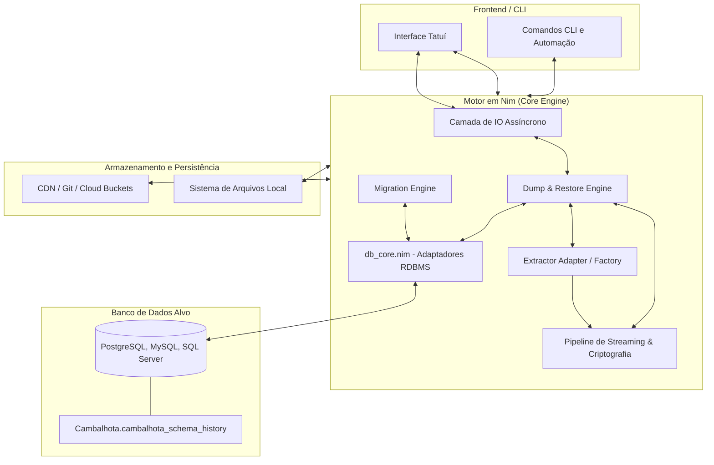

# Mapa Arquitetural — Cambalhota

## Visão Geral
O **Cambalhota** é uma ferramenta CLI/TUI nativa compilada em **Nim** (com gestão de memória via ORC), focada no controle de versão estrutural de bancos de dados relacionais e rotinas de extração/restauração (dumps e backups). O design foi projetado para assegurar robustez de I/O, previsibilidade transacional em migrações e uma experiência visual interativa diretamente no terminal.

## Diagrama de Blocos Arquiteturais

## Detalhamento dos Componentes Técnicos

### 1. Camada de UI (Frontend / CLI)
- **TUI Tatuí:** Provê toda a experiência visual rica via terminal para interatividade humana.
  - Implementa um Design System unificado (Dark mode, fontes monoespaçadas, destaques semânticos de cores).
  - Organiza funcionalidades complexas em abas intuitivas (Extrator, Relatórios de Auditoria, Restauração).
- **CLI Utilities:** Interface programática *headless* para orquestração (via CI/CD) e disparo automatizado de comandos.
  - Utiliza `parseopt` para validação rigorosa de parâmetros, implementando um *Hard Block* ativo que aborta a extração (ex: barrando o schema `public`) e injeta estados de erro (`stError`) na thread da UI para feedback imediato ao usuário.

### 2. Motor em Nim (Backend / Core Engine)
Construído com gestão `ORC` para maximizar a previsibilidade e diminuir a latência do garbage collector, lidando de modo eficiente com volumes altos de leitura/escrita e redes.

#### Camada de IO Assíncrono (Processos em Background)
- Desacopla execuções pesadas (como o streaming do `pg_dump`) da Thread Principal através de Threads e Canais (`Channel[Msg]`).
- Assegura que a UI Tatuí nunca congele durante I/O, repassando status e logs em tempo real (Promessa Fail-safe).

#### `db_core.nim` (Camada de Acesso RDBMS)
- Driver agnóstico que atua como tradutor de dialetos para PostgreSQL, MySQL e SQL Server.
- Realiza consultas na `information_schema` e converte metadados (tipos, schemas e views) para a abstração interna do Cambalhota.

#### Migration Engine
Uma implementação Flyway-like responsável pela evolução contínua da estrutura do banco.
- **Nomenclatura Semântica:** Lê do disco os arquivos de versão estruturados (`V{Timestamp}__{Desc}.up.sql` para Up e `V{Timestamp}__{Desc}.down.sql` para Rollback).
- **Controle Concorrente e Transacional:** Aplica Lockings (ex: `pg_advisory_lock` ou lock table) para evitar corridas ao atualizar o schema, blindando as execuções dentro de blocos transacionais explícitos (`BEGIN/COMMIT`) em bancos suportados.
- **Rastreio e Auditoria:** Registra a evolução em `Cambalhota.cambalhota_schema_history`, registrando timestamps, durações, autoria e os respectivos *checksums* anti-adulteração de arquivos.
- **Automação de Diffing:** Extrai as assinaturas de tabelas, índices e *constraints* de dois estados do banco e sugere proativamente as migrações (Up/Down) do *delta* das diferenças.

#### Dump & Restore Engine
- Orquestra extrações unificadas e estruturadas em arquivos padrão (`yyyy-mm-dd_..._dump-db.sql`).
- Executa rotinas completas de *restore* do banco, permitindo inclusive o mock e a carga de fixtures localmente.
- **Extractor Adapter / Factory Pattern:** Resolve e instancia dinamicamente o utilitário nativo de dump compatível com o banco alvo (ex: `pg_dump`, `mysqldump`, `mongodump`), tornando a arquitetura agnóstica ao motor de dados.
- **Segurança e Otimização:** Delega processamento pesado ao *Pipeline de Streaming & Criptografia* (ADR-004), interceptando a saída universal do utilitário instanciado (`stdout`) e operando em pedaços contínuos. A compressão (`std/zlib`) e a criptografia E2E (`nimcrypto` AES-256) ocorrem on-the-fly por blocos, blindando a memória contra falhas OOM. Em paralelo, a *worker thread* alimenta a interface com o status dos blocos processados via canais (`Channel`).

### 3. Integração Remota (Persistência Off-Site)
- **CDN / Git Connectors:** Adaptador responsável pelo offload autônomo dos dumps massivos gerados no Core e recuperação de listagens históricas.
- Provê interface fluída para sincronizar a TUI Tatuí com S3, GCP Buckets, Google Drive, ou repositórios Git, garantindo centralização e governança dos schemas guardados.
