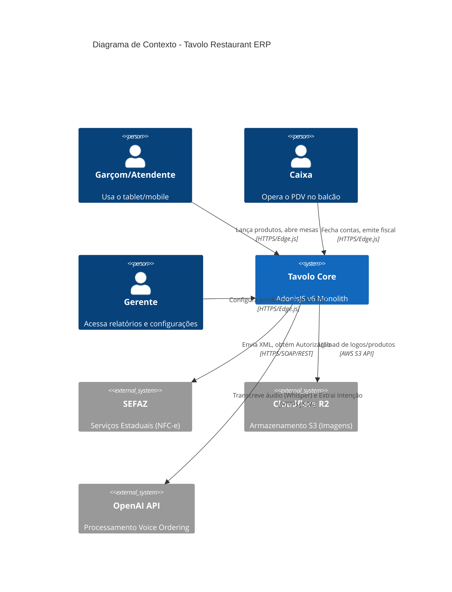

# Mapa de Arquitetura (Tavolo)

## 1. Topologia Macro

O Tavolo adota uma arquitetura MVC Monolítica First (Modular Monolith) utilizando o ecossistema AdonisJS v6, focado em altíssima produtividade, type-safety e renderização server-side (BHTML/SSR).

## 2. Arquitetura Interna (MVC e Camadas)

- **Router (`start/routes.ts`):** Definição estrita das rotas HTTP.
- **Controllers (`app/controllers/`):** Camada fina, responsável por capturar o request, chamar validadores Vine.js, orquestrar Services e retornar a resposta (Render de View ou JSON).
- **Validators (`app/validators/`):** Regras do Vine.js.
- **Services (`app/services/`):** Onde reside a lógica de negócio pesada (Ex: `FiscalEmissionService`, `OrderLifecycleService`).
- **Models (`app/models/`):** Representação do Banco de Dados via Lucid ORM. Toda regra de relacionamento (HasMany, BelongsTo) e hooks de lifecycle ficam aqui.
- **Views (`resources/views/`):** Templates Edge.js, usando `Alpine.js` para reatividade local no client (sem necessidade de SPAs pesados) e `Tailwind CSS`.

## 3. Topologia de Banco de Dados

- **PostgreSQL 16+**
- Uso OBRIGATÓRIO do schema `tavolo` (Configurado via `DATABASE_SCHEMA`).
- **Isolamento de Tenant:** Todas as tabelas que pertencem a um restaurante devem possuir uma FK para `empresas(id)` nomeada `empresa_id`.

## 4. Estratégia de Deploy
- **Ambiente:** Heroku (Web Dyno).
- **Build:** `npm run build` transpila TypeScript para JavaScript puro.
- **Start:** O servidor sobe via `node build/bin/server.js`.
