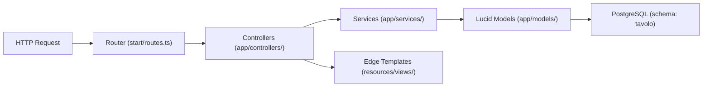

# Constituição de Engenharia — tavolo

> **Contrato inviolável.** Este documento é a lei suprema de engenharia do projeto tavolo. Todo agente, desenvolvedor ou pipeline de CI/CD **DEVE** obedecer às regras aqui listadas. Violações devem ser bloqueadas em code review e, quando possível, detectadas automaticamente por linters e testes.

**Última atualização:** 2026-07-16
**Status:** Em vigor
**Referências cruzadas:**
- [scope.md](../scope.md) — Escopo estratégico e fronteiras do produto
- [architecture_map.md](architecture_map.md) — Mapa arquitetural de componentes e fluxos
- [instrumentation.md](instrumentation.md) — Padrões de observabilidade e logging estruturado

---

## 1. Regras de Banco de Dados

| # | Regra | Nível |
|---|-------|-------|
| DB-01 | ⛔ **PROIBIDO usar o schema `public`** do PostgreSQL. Todo objeto de banco (tabelas, views, functions, indexes, sequences, triggers) **DEVE** ser criado exclusivamente no schema `tavolo` (ou via variável de ambiente `DATABASE_SCHEMA`). Qualquer código que referencie `public` — explícita ou implicitamente — **DEVE** ser rejeitado em code review. | ⛔ Forbidden |
| DB-02 | ✅ O ORM Oficial é o **Lucid ORM**. Consultas brutas (raw queries) só devem ser utilizadas quando o ORM não suportar a operação, e sempre através do query builder seguro do Lucid para prevenir SQL injection. | ✅ Obrigatório |
| DB-03 | ✅ Toda migration **DEVE** definir o schema explicitamente nas tabelas ou garantir que está rodando no schema correto. Em AdonisJS, isso pode ser configurado globalmente no arquivo de database ou explicitamente na schema definition: `this.schema.withSchema('tavolo').createTable(...)`. | ✅ Obrigatório |
| DB-04 | ⛔ Credenciais de banco **NUNCA** devem existir no código-fonte. Devem ser lidas do `.env` (em ambiente de dev) ou variáveis de ambiente de sistema (em produção via Heroku). | ⛔ Forbidden |
| DB-05 | ✅ Charset do banco **DEVE** ser **UTF-8**. | ✅ Obrigatório |

---

## 2. Regras de Segurança e Acesso

### 2.1. Autenticação e Autorização

| # | Regra | Nível |
|---|-------|-------|
| SEC-01 | ✅ Autenticação via **AdonisJS Auth** (Session-based ou Web API tokens). A lógica de permissões e autorizações (Bouncer/Policies) deve ser usada para controlar acesso a recursos por tenant. | ✅ Obrigatório |
| SEC-02 | ✅ **Hierarquia de papéis** para um restaurante: | ✅ Obrigatório |

```
superadmin > admin_rede > gerente_loja > caixa > garçom > visualização
```

### 2.2. Multi-tenancy (Empresas/Restaurantes)

| # | Regra | Nível |
|---|-------|-------|
| TEN-01 | ✅ Todos os dados que pertencem a um restaurante devem possuir uma chave estrangeira para a tabela de empresas (`empresa_id`). | ✅ Obrigatório |
| TEN-02 | ✅ Rotas e queries relacionadas a recursos de uma empresa devem estar **sempre scoped** pelo `empresa_id` do usuário autenticado. O acesso cruzado de dados entre tenants diferentes é terminantemente proibido (exceto para `superadmin`). | ✅ Obrigatório |

---

## 3. Padrões de Código (Full-stack TypeScript)

Stack aprovada conforme `AGENTS.md`.

### 3.1. Stack Obrigatória

| Componente | Tecnologia | Nota |
|-----------|------------|---------------|
| Linguagem | TypeScript | Modo estrito (`strict: true`) no `tsconfig.json` |
| Framework | AdonisJS v6 | Backend e MVC Server-rendered |
| ORM / Query Builder | Lucid ORM | Modelagem de dados e persistência |
| Validação | Vine.js | Validação robusta e tipada de inputs |
| Views / Templates | Edge.js | Renderização server-side |
| Estilização | Tailwind CSS | CSS Utility-first, sem bibliotecas externas pesadas |
| Test Runner | Japa | Testes unitários, de integração e testes de API |

### 3.2. Arquitetura MVC (AdonisJS)



✅ Regras de camadas:

| Regra | Descrição |
|-------|-----------|
| ✅ **Controllers** | Controllers devem ser magros. Responsáveis apenas por receber a requisição HTTP, invocar validadores (Vine.js), passar para um Service e retornar a View/JSON. |
| ✅ **Services** | Lógica de negócios pesada deve viver em `app/services/`. Eles são invocados pelos Controllers. |
| ✅ **Models** | Representam a estrutura das tabelas. Utilizar relacionamentos e scopes do Lucid ORM. Não devem conter lógica de negócio externa. |
| ⛔ **Proibido** | Acesso ao banco de dados diretamente das Views (Edge.js) ou validação inline sem usar Vine.js. |

---

## 4. Padrões de Frontend (Edge.js + Tailwind)

### 4.1. Estilização

- **Tailwind CSS**: A estilização deve ser feita usando classes do Tailwind. Evitar arquivos CSS arbitrários, exceto para o entrypoint `app.css`.
- **Acessibilidade e Componentização**: Mesmo utilizando renderização server-side com Edge, crie componentes em Edge (via tags `@component`) para botões, inputs, modais e layouts a fim de manter consistência visual.

### 4.2. Responsividade

- A aplicação deve ser utilizável em dispositivos móveis (telas de garçom) e desktops/PDVs (caixa/gerência). Utilize as classes de breakpoint do Tailwind (`sm:`, `md:`, `lg:`).

---

## 5. Restrições de Bibliotecas

### ⛔ Bibliotecas e Frameworks PROIBIDOS

| # | Restrição | Motivo |
|---|-----------|--------|
| LIB-01 | ⛔ **NÃO usar Rust (Actix/sqlx) ou Flutter** | O projeto migrou definitivamente para AdonisJS v6 (TypeScript/Node.js). Artefatos antigos dessas tecnologias são legados e devem ser evitados/removidos. |
| LIB-02 | ⛔ **NÃO usar React/Angular/Vue sem aprovação** | A renderização padrão é Server-Side via Edge.js + Alpine.js. SPA pesados apenas se estritamente necessários e aprovados via ADR. |
| LIB-03 | ⛔ **NÃO misturar ORMs (Prisma, TypeORM)** | O Lucid ORM é parte integrante e oficial do AdonisJS. O uso de outro ORM causa conflitos de arquitetura. |

---

## 6. Padrões de Qualidade

Regras de qualidade que todo código **DEVE** cumprir antes de ser aceito em merge.

| # | Regra | Comando | Nível |
|---|-------|---------|-------|
| QA-01 | ✅ TypeScript **DEVE** compilar sem erros | `npm run typecheck` | ✅ Obrigatório |
| QA-02 | ✅ Linter **DEVE** passar sem erros | `npm run lint` | ✅ Obrigatório |
| QA-03 | ✅ Testes **DEVEM** passar integralmente | `npm test` | ✅ Obrigatório |
| QA-04 | ✅ Deploy **DEVE** ser precedido por build de produção bem-sucedido | `npm run build` | ✅ Obrigatório |

---

## Checklist de Conformidade (Code Review)

Antes de aprovar ou commitar qualquer funcionalidade, verifique:

- [ ] Nenhuma referência ao schema `public` (migrations usam `tavolo`).
- [ ] O Controller está magro e as validações usam Vine.js.
- [ ] Testes no Japa foram escritos para a funcionalidade (se aplicável).
- [ ] `npm run typecheck` e `npm run lint` passam com sucesso.
- [ ] As Views (Edge.js) não fazem consultas diretas ao banco.
- [ ] Estilos usam Tailwind CSS sem violações.
- [ ] Operações críticas (Fiscal, Emissão de NFC-e) foram isoladas em services específicos.

---

> **Este documento é a referência final.** Em caso de conflito com qualquer outro documento de engenharia, as regras desta Constituição prevalecem.
