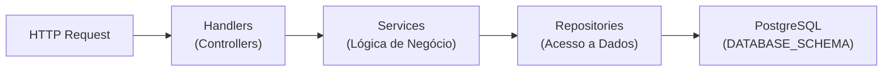
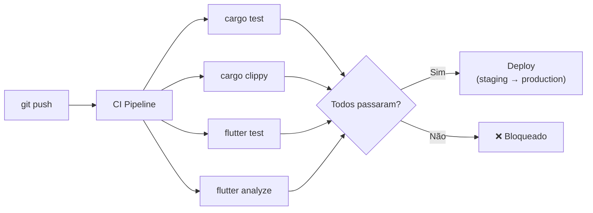

# Constituição de Engenharia — Veterin

> **Contrato inviolável.** Este documento é a lei suprema de engenharia do projeto Veterin. Todo agente, desenvolvedor ou pipeline de CI/CD **DEVE** obedecer às regras aqui listadas. Violações devem ser bloqueadas em code review e, quando possível, detectadas automaticamente por linters e testes.

**Última atualização:** 2026-07-10  
**Status:** Em vigor  
**Referências cruzadas:**
- [scope.md](../scope.md) — Escopo estratégico e fronteiras do produto
- [architecture_map.md](architecture_map.md) — Mapa arquitetural de componentes e fluxos
- [instrumentation.md](instrumentation.md) — Padrões de observabilidade e logging estruturado

---

## 1. Regras de Banco de Dados

Todas as regras desta seção derivam das seções §4.1, §4.2 e §6.3 do [scope.md](../scope.md).

| # | Regra | Nível |
|---|-------|-------|
| DB-01 | ⛔ **PROIBIDO usar o schema `public`** do PostgreSQL. Todo objeto de banco (tabelas, views, functions, indexes, sequences, triggers) **DEVE** ser criado exclusivamente no schema retornado pela variável de ambiente `DATABASE_SCHEMA`. Qualquer código que referencie `public` — explícita ou implicitamente — **DEVE** ser rejeitado em code review. | ⛔ Forbidden |
| DB-02 | ✅ Todas as queries **DEVEM** utilizar prepared statements via macros `sqlx::query!` ou `sqlx::query_as!`. Concatenação de input do usuário em strings SQL é **ESTRITAMENTE PROIBIDA**. | ✅ Obrigatório |
| DB-03 | ✅ Toda migration SQL **DEVE** iniciar com `SET search_path TO <DATABASE_SCHEMA>;` como primeira instrução executável. Nunca omitir o schema. | ✅ Obrigatório |
| DB-04 | ✅ O `PgPool` (sqlx) **DEVE** ser configurado com `search_path` via parâmetro `options=-c search_path=<DATABASE_SCHEMA>` na `DATABASE_URL`, garantindo que toda conexão do pool opere no schema correto por padrão. | ✅ Obrigatório |
| DB-05 | ⛔ Credenciais de banco **NUNCA** devem existir no código-fonte. `DATABASE_URL`, `DATABASE_SCHEMA`, `JWT_SECRET` e demais segredos **DEVEM** ser lidos exclusivamente de variáveis de ambiente (injetadas pelo Heroku). | ⛔ Forbidden |
| DB-06 | ✅ Charset do banco **DEVE** ser **UTF-8**. | ✅ Obrigatório |
| DB-07 | ✅ Migrations gerenciadas via `sqlx migrate` com arquivos SQL versionados no diretório `migrations/`. Executadas automaticamente no deploy ou via `sqlx migrate run`. | ✅ Obrigatório |
| DB-08 | ✅ Backup automatizado via Heroku Postgres (`heroku pg:backups:schedule`). Backup manual via `heroku pg:backups:capture` antes de migrations destrutivas. | ✅ Obrigatório |
| DB-09 | ✅ **Criação de Schema**: Migrations estruturais que estabelecem o namespace do projeto **DEVEM** incluir a criação do schema de forma idempotente (`CREATE SCHEMA IF NOT EXISTS <schema>;`). | ✅ Obrigatório |
| DB-10 | ✅ **Rollback (Down)**: Todas as migrations **DEVEM** possuir arquivos pareados `.up.sql` e `.down.sql` (ou suporte equivalente para revert) definindo as etapas completas de rollback da alteração. | ✅ Obrigatório |

### Exemplo de migration válida

```sql
-- migrations/20260710_001__create_animals.up.sql
CREATE SCHEMA IF NOT EXISTS veterin; -- ← Garante a existência do schema
SET search_path TO veterin;          -- ← Define o contexto: SEMPRE

CREATE TABLE animals (
    id          UUID PRIMARY KEY DEFAULT gen_random_uuid(),
    tenant_id   UUID NOT NULL REFERENCES tenants(id),
    chip        VARCHAR(50),
    nome        VARCHAR(255) NOT NULL,
    -- ...demais campos...
    created_at  TIMESTAMPTZ NOT NULL DEFAULT now(),
    updated_at  TIMESTAMPTZ NOT NULL DEFAULT now()
);
```

### Exemplo de conexão válida (Rust)

```rust
// src/config.rs
use std::env;

pub fn database_url() -> String {
    let base_url = env::var("DATABASE_URL")
        .expect("DATABASE_URL must be set");
    let schema = env::var("DATABASE_SCHEMA")
        .unwrap_or_else(|_| "veterin".to_string());
    format!("{}?options=-c search_path={}", base_url, schema)
}
```

---

## 2. Regras de Segurança

Regras derivadas das seções §1.1, §1.2 e §6.2 do [scope.md](../scope.md).

### 2.1. Autenticação e Autorização

| # | Regra | Nível |
|---|-------|-------|
| SEC-01 | ✅ Autenticação via **JWT** usando a crate `jsonwebtoken`. Tokens devem conter claims de `user_id`, `tenant_id`, `role`, `exp` e, em sessões de impersonação, `acting_as`, `original_user`. | ✅ Obrigatório |
| SEC-02 | ✅ **Hierarquia de papéis** (ordem decrescente de privilégio): | ✅ Obrigatório |

```
superadmin > admin > coordenador > voluntário > veterinário > visualização
```

| # | Regra | Nível |
|---|-------|-------|
| SEC-03 | ✅ `admin` pode criar **papéis customizados** com permissões granulares por recurso, porém papéis customizados **NUNCA** podem ter privilégios iguais ou superiores ao papel `admin`. | ✅ Obrigatório |
| SEC-04 | ⛔ Um `admin` **NÃO PODE** promover outro usuário a `admin` ou `superadmin`. Somente `superadmin` pode fazê-lo. | ⛔ Forbidden |

### 2.2. Reset de Senha — Regras por Hierarquia

| Cenário | Quem executa | Alvo | Canal | Requisito adicional |
|---------|-------------|------|-------|---------------------|
| 🔑 Reset de não-admin | `admin` | `coordenador`, `voluntário`, `veterinário`, `visualização` (do seu tenant) | Admin Panel | — |
| 🔑 Reset de admin | `superadmin` | `admin` (de qualquer tenant) | Admin Panel | **Motivo textual obrigatório** antes da execução |
| 🔑 Reset de superadmin | Operação de infraestrutura | `superadmin` | `heroku run` com script dedicado | Documentado em runbook; **NUNCA** via interface do sistema |

✅ **Todo reset de senha**, independentemente do nível, **DEVE** gerar um registro de auditoria imutável contendo:
- `executor_id` (quem executou)
- `target_user_id` (cuja senha foi resetada)
- `timestamp`
- `ip_address`
- `reason` (motivo)

### 2.3. Impersonação de Usuários

| Executor | Pode impersonar | Restrição |
|----------|-----------------|-----------|
| `admin` | Usuários **não-admin** do **seu próprio tenant** | — |
| `superadmin` | Qualquer usuário de qualquer tenant, **incluindo `admin`** | — |
| Qualquer | ⛔ **NINGUÉM** pode impersonar um `superadmin` | ⛔ Forbidden |

✅ Regras obrigatórias de impersonação:

- **Auditoria:** Toda sessão gera registro imutável com `admin_id`, `target_user_id`, `tenant_id`, `started_at`, `ended_at`, `ip_address`, `user_agent`, `reason` (motivo textual obrigatório preenchido antes de iniciar).
- **Ações rastreáveis:** Toda ação durante impersonação é registrada com referência ao `impersonation_session_id`.
- **Indicador visual:** Banner fixo e proeminente na interface Flutter com botão "Encerrar Impersonação" sempre visível.
- **Histórico:** Histórico completo e pesquisável de sessões, acessível por `admin` (seu tenant) e `superadmin` (todos os tenants).
- ⛔ **Restrições:** Impersonação **NÃO PERMITE** alterar senha, email ou papéis do usuário impersonado.
- ✅ **JWT:** Tokens de impersonação **DEVEM** conter claims distintos: `acting_as`, `original_user`, `tenant_id`.

### 2.4. Proteções Transversais

| # | Regra | Nível |
|---|-------|-------|
| SEC-05 | ✅ CORS configurado via middleware `actix-cors`. | ✅ Obrigatório |
| SEC-06 | ✅ Validação de input via crate `validator` com feedback estruturado de erros. | ✅ Obrigatório |
| SEC-07 | ✅ **Toda operação privilegiada** (reset de senha, impersonação, alteração de papéis, exclusão de dados, alterações de configuração) **DEVE** gerar um audit log imutável. | ✅ Obrigatório |
| SEC-08 | ✅ SSL obrigatório na conexão com Heroku Postgres. | ✅ Obrigatório |

---

## 3. Padrões de Código Rust (Backend)

Stack aprovada conforme [scope.md §6.2](../scope.md).

### 3.1. Stack Obrigatória

| Componente | Tecnologia | Versão / Nota |
|-----------|------------|---------------|
| Linguagem | Rust | Edição 2021+, stable channel |
| Framework Web | `actix-web` | 4.x |
| ORM / Query Builder | `sqlx` | Async, compile-time checked queries |
| Serialização | `serde` + `serde_json` | JSON |
| Logging | `tracing` + `tracing-subscriber` | JSON structured — ver [instrumentation.md](instrumentation.md) |
| Autenticação | `jsonwebtoken` | JWT |
| Validação | `validator` | Feedback estruturado |
| CORS | `actix-cors` | Middleware |
| Error handling | `thiserror` | Erros tipados + respostas HTTP Actix-web |

### 3.2. Arquitetura em Camadas (DDD)



✅ Regras de camadas:

| Regra | Descrição |
|-------|-----------|
| ✅ **Handlers** | Recebem request HTTP, validam input, delegam ao Service e retornam response. Sem lógica de negócio. |
| ✅ **Services** | Contêm regras de negócio. Orquestram chamadas a Repositories. Sem acesso direto ao HTTP. |
| ✅ **Repositories** | Executam queries SQL via `sqlx`. Sem lógica de negócio, sem acesso ao HTTP. |
| ⛔ **Proibido** | Lógica de negócios acoplada à camada de apresentação (handlers ou frontend). |

### 3.3. Error Handling

```rust
// src/errors.rs — Exemplo de padrão obrigatório
use thiserror::Error;

#[derive(Error, Debug)]
pub enum AppError {
    #[error("Recurso não encontrado: {0}")]
    NotFound(String),
    #[error("Acesso negado")]
    Forbidden,
    #[error("Erro de validação: {0}")]
    Validation(String),
    #[error("Erro interno")]
    Internal(#[from] anyhow::Error),
}

impl actix_web::ResponseError for AppError {
    fn error_response(&self) -> actix_web::HttpResponse {
        // Mapeamento para HTTP status codes
        // ...
    }
}
```

---

## 4. Padrões de Código Flutter (Frontend)

Stack aprovada conforme [scope.md §6.1](../scope.md) e §5.1.

### 4.1. Stack Obrigatória

| Componente | Tecnologia | Nota |
|-----------|------------|------|
| Framework | Flutter | Stable channel, versão mais recente |
| State management | `Riverpod` (recomendado) ou `Bloc/Cubit` | Gerenciamento reativo + injeção de dependências |
| Roteamento | `go_router` | Navegação declarativa com deep linking |
| HTTP Client | `dio` ou `http` | Comunicação com API REST Rust |
| Ícones | Material Icons + `font_awesome_flutter` | — |
| Formulários | `Form`, `TextFormField`, `DropdownButtonFormField` | Validação integrada |

### 4.2. Design System — Componentes Obrigatórios

✅ Widgets customizados reutilizáveis:

| Widget | Propósito |
|--------|-----------|
| `FormInput` | Campo de texto estilizado com glow no focus |
| `FormSelect` | Dropdown estilizado |
| `PrimaryButton` | Botão principal com animação suave |
| `ModernTable` | Tabela com zebra-striping, hover e colunas sticky |
| `StatCard` | Card de estatística para dashboard |
| `StatusBadge` | Badge colorido para status, sexo e saúde |
| `AlertBanner` | Banner de alerta/notificação |

### 4.3. Tema e Paleta de Cores

✅ **Dark-mode como padrão**, com a seguinte paleta (conforme [scope.md §5.1](../scope.md)):

| Função | Cor | Hex |
|--------|-----|-----|
| Primária | Azul | `#3b82f6` |
| Sucesso | Verde | `#10b981` |
| Perigo | Vermelho | `#ef4444` |
| Destaque | Roxo | `#8b5cf6` |
| Alerta | Amarelo | `#f59e0b` |
| Feminino (badge) | Pink | `#ec4899` |
| Masculino (badge) | Azul | `#3b82f6` |
| Secundário | Cinza | `#6b7280` |
| Fundo | Azul escuro | `#1a1a2e` |
| Cards | Azul médio | `#16213e` |
| Acento | Azul/Coral | `#0f3460` / `#e94560` |

### 4.4. Responsividade

✅ Layout adaptativo obrigatório com 3 breakpoints:

| Breakpoint | Largura | Navegação |
|-----------|---------|-----------|
| Mobile | < 768px | `Drawer` com menu hamburger |
| Tablet | 768–1024px | `NavigationRail` colapsável |
| Desktop | > 1024px | Sidebar expandida |

✅ Implementar via `LayoutBuilder` + `MediaQuery` com adaptação automática por plataforma.

### 4.5. Efeitos Visuais

| Efeito | Implementação |
|--------|---------------|
| Glassmorphism | `BackdropFilter` |
| Micro-animações | `AnimatedContainer`, `Hero` |
| Transições | 300ms em elementos interativos |
| Colunas sticky | `DataTable` com chip e nome fixos |

---

## 5. Restrições de Bibliotecas

Regras de dependências para evitar desvios da stack aprovada.

### ⛔ Bibliotecas e Frameworks PROIBIDOS

| # | Restrição | Motivo |
|---|-----------|--------|
| LIB-01 | ⛔ **NÃO usar jQuery** no frontend | Projeto Flutter — sem dependências JavaScript legadas |
| LIB-02 | ⛔ **NÃO usar Angular** no frontend | Stack aprovada é Flutter |
| LIB-03 | ⛔ **NÃO usar React** no frontend | Stack aprovada é Flutter |
| LIB-04 | ⛔ **NÃO usar Diesel como padrão** no backend | `sqlx` é o ORM padrão. Diesel só pode ser introduzido como alternativa formalmente documentada via ADR (Architecture Decision Record) |
| LIB-05 | ⛔ **NÃO usar frameworks PHP** (Laravel, Symfony, CodeIgniter, etc.) | Projeto migrado de PHP para Rust — stack anterior é legado |
| LIB-06 | ⛔ **NÃO carregar dependências via CDN** no Flutter | Flutter compila assets; dependências devem ser declaradas em `pubspec.yaml` |
| LIB-07 | ⛔ **NÃO manter dependências não utilizadas** em `Cargo.toml` ou `pubspec.yaml` | Manter manifiestos limpos |

---

## 6. Padrões de Qualidade

Regras de qualidade que todo código **DEVE** cumprir antes de ser aceito em merge.

| # | Regra | Comando | Nível |
|---|-------|---------|-------|
| QA-01 | ✅ Testes unitários obrigatórios para **todo código novo** | `cargo test` / `flutter test` | ✅ Obrigatório |
| QA-02 | ✅ `cargo clippy` **DEVE** passar sem warnings | `cargo clippy -- -D warnings` | ✅ Obrigatório |
| QA-03 | ✅ `flutter analyze` **DEVE** passar sem erros | `flutter analyze` | ✅ Obrigatório |
| QA-04 | ✅ Pipeline de CI/CD obrigatório antes de **qualquer deploy** | GitHub Actions ou Heroku Pipelines | ✅ Obrigatório |
| QA-05 | ⛔ **PROIBIDO** deploy manual direto via `git push heroku` sem pipeline | — | ⛔ Forbidden |

### Pipeline CI/CD Mínimo



---

## 7. Restrições de Escopo (Forbidden)

Itens absolutamente fora do escopo do produto, conforme [scope.md §4.1](../scope.md). Qualquer tentativa de implementar estes itens **DEVE** ser rejeitada.

| # | Restrição | Detalhamento |
|---|-----------|-------------|
| SCOPE-01 | ⛔ **Uso do schema `public` do PostgreSQL** | É **ESTRITAMENTE PROIBIDO** criar tabelas, views, functions ou qualquer objeto no schema `public` do Heroku Postgres. Todo o acesso ao banco **DEVE** utilizar exclusivamente o schema retornado pela variável de ambiente `DATABASE_SCHEMA`. Queries, migrations e conexões devem configurar o `search_path` para o valor de `DATABASE_SCHEMA`. Qualquer código que referencie `public` explícita ou implicitamente deve ser rejeitado em code review. |
| SCOPE-02 | ⛔ **Funcionalidades de e-commerce ou pagamento online** | O sistema não deve processar transações financeiras nem integrar gateways de pagamento. Módulos financeiros futuros devem ser limitados a controle contábil interno. |
| SCOPE-03 | ⛔ **Armazenamento de dados pessoais sensíveis de humanos** | O sistema não deve coletar CPF, RG, endereço completo ou dados bancários de tutores ou adotantes sem prévia análise de conformidade com a LGPD. |
| SCOPE-04 | ⛔ **Funcionalidades de rede social ou fórum** | O sistema não é uma plataforma social. Comentários públicos, perfis de usuário visíveis externamente e feeds de atividade estão fora do escopo. |
| SCOPE-05 | ⛔ **Inteligência artificial ou machine learning** | Reconhecimento facial de animais, predição de saúde ou qualquer modelo de ML está fora do escopo deste produto. |

---

## 8. Anti-padrões (Avoid)

Práticas que **DEVEM** ser evitadas para manter a qualidade e segurança do projeto, conforme [scope.md §4.2](../scope.md).

| # | Anti-padrão | Prática correta |
|---|-------------|-----------------|
| ANTI-01 | ⛔ **Concatenação de input do usuário em queries SQL** | ✅ Usar prepared statements via `sqlx` (macros `query!` / `query_as!`). Rust previne SQL injection em tempo de compilação quando usado corretamente. |
| ANTI-02 | ⛔ **Credenciais de banco hardcoded no código-fonte** | ✅ `DATABASE_URL`, `DATABASE_SCHEMA` e demais variáveis do Heroku Postgres devem ser lidas exclusivamente de variáveis de ambiente. Nenhuma credencial deve existir no código-fonte. |
| ANTI-03 | ⛔ **Uso implícito do schema `public`** | ✅ Nunca omitir o schema nas queries ou migrations. Sempre qualificar tabelas com o schema de `DATABASE_SCHEMA` (ex: `SET search_path TO $DATABASE_SCHEMA`) ou usar `sqlx` configurado com `options=-c search_path=<schema>` na `DATABASE_URL`. |
| ANTI-04 | ⛔ **Lógica de negócios acoplada à apresentação** | ✅ Manter separação rigorosa entre camadas: API Rust (handlers → services → repositories) e UI Flutter (screens → widgets → providers/blocs). |
| ANTI-05 | ⛔ **Acúmulo de artefatos legados** | ✅ Arquivos da stack anterior (`.php`, `_old.php`, `.bak`, `.odt`) devem ser removidos do diretório de produção e preservados apenas no histórico do Git. |
| ANTI-06 | ⛔ **Dependências não utilizadas** | ✅ Manter `Cargo.toml` (Rust) e `pubspec.yaml` (Flutter) limpos — sem crates ou packages declarados mas não utilizados. |
| ANTI-07 | ⛔ **Deploy sem pipeline de CI/CD** | ✅ Implementar pipeline com `cargo test`, `flutter test` e análise estática (`cargo clippy`, `flutter analyze`) antes do deploy. Evitar deploy manual direto via `git push heroku`. |
| ANTI-08 | ⛔ **Expansão do almoxarifado antes de consolidar o core** | ✅ O módulo de inventário não deve receber novas funcionalidades enquanto o cadastro de animais não tiver autenticação, validação e segurança resolvidas na nova stack Rust/Flutter. |

---

## Checklist de Conformidade

Antes de abrir qualquer Pull Request, verifique:

- [ ] Nenhuma referência ao schema `public` no código
- [ ] Todas as queries usam `sqlx::query!` / `sqlx::query_as!` (prepared statements)
- [ ] Migrations iniciam com `SET search_path TO <DATABASE_SCHEMA>`
- [ ] Nenhuma credencial hardcoded no código-fonte
- [ ] Testes unitários escritos para código novo
- [ ] `cargo clippy -- -D warnings` passa sem erros
- [ ] `flutter analyze` passa sem erros
- [ ] `cargo test` passa
- [ ] `flutter test` passa
- [ ] Operações privilegiadas geram audit log
- [ ] Tokens JWT contêm claims corretos
- [ ] Nenhuma dependência proibida adicionada (jQuery, Angular, React, PHP, Diesel sem ADR)
- [ ] Nenhuma dependência não utilizada nos manifestos
- [ ] Layout responsivo testado nos 3 breakpoints
- [ ] Design system utiliza widgets customizados padronizados

---

> **Este documento é a referência final.** Em caso de conflito com qualquer outro documento, as regras desta Constituição prevalecem. Alterações neste documento requerem aprovação da liderança técnica.
